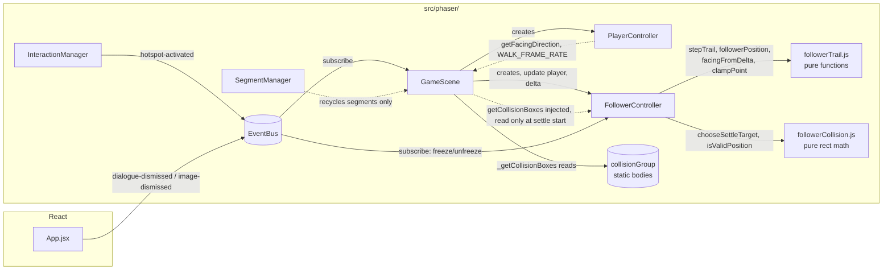
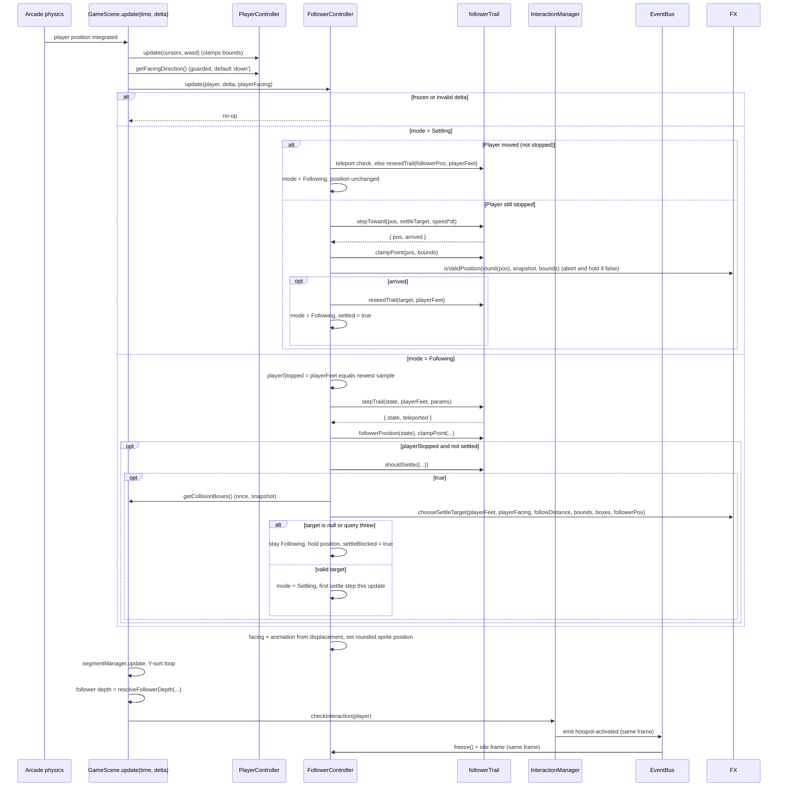
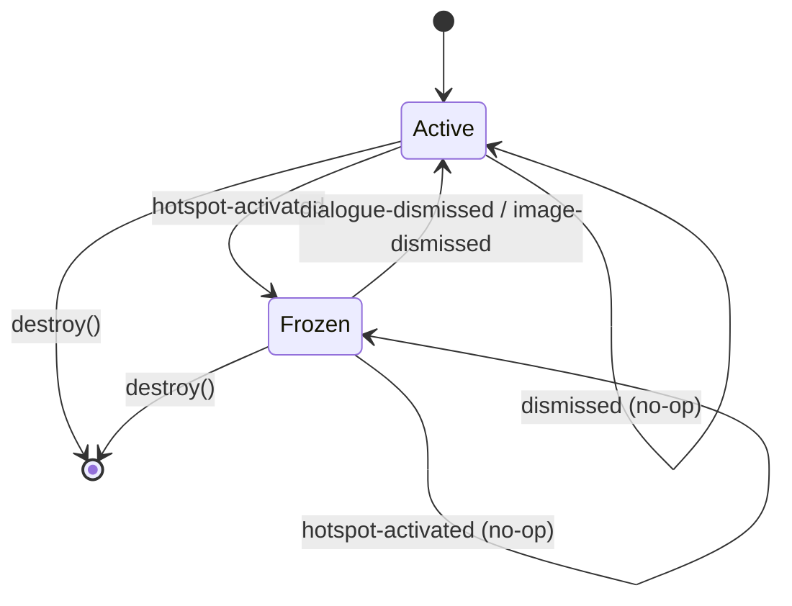
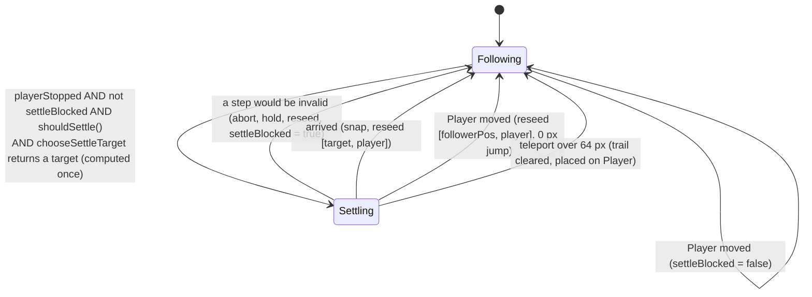

# Design Document: Follower Companion

## Overview

This feature adds Kelly, a purely visual companion who trails Lorenzo through the gallery like a Pokémon party member. Kelly does not steer toward the player. She replays the path the player actually walked, so turning around, zig-zagging, and corners all look natural.

The design has three layers, following the project's boundary rules (game logic in `phaser/`, no React, no new EventBus events):

1. **`followerTrail.js`** is a Phaser-free module of pure functions. It holds all trail recording, trimming, sampling, facing, frame-index, depth-tie, clamp, rest-spot and settle arithmetic. Inputs and outputs are plain `{x, y}` objects and numbers. This is where almost all property-based tests live (Req 12).
   A sibling, **`followerCollision.js`**, is also Phaser-free. It holds the footprint, rectangle-overlap, validity, segment-sweep and settle-target selection functions used by Req 13 (Req 12.8).
2. **`FollowerController.js`** is a class with JSDoc, mirroring `PlayerController`. It owns the Kelly sprite, the trail state, animations, facing, freeze/unfreeze and EventBus subscriptions. The scene, sprite, EventBus, follow distance, speed and bounds are all injected (Req 12.2).
3. **`GameScene.js` wiring** loads the sheet, builds the sprite (no physics body), puts it in the Y-sort group, calls the controller once per frame after the player has moved, and tears it down on shutdown.

### Key design decision: the trail stores a "gap", not a follower point

Req 2.4 and Req 3.3 interact in a way that a naive "drop oldest samples" trail cannot satisfy (see the reconciliation table). Instead, the trail state is:

- `samples`: ordered Player feet positions, oldest first (the recorded polyline).
- `gap`: the Path_Length, measured along `samples` from the newest sample backward, at which the Follower stands.

The Follower's position is always `pointAtDistanceFromEnd(samples, gap)`. This gives the required behavior almost for free:

- **Path membership** (Req 4.7): the position is by construction a point on the polyline.
- **Following** (Req 3.x): when the Player extends the trail by `ℓ`, `gap` grows by `ℓ` and the Follower stays put. Each frame the Follower then advances by reducing `gap` toward Follow_Distance, by at most `speed × dt`.
- **Backtracking** (Req 4.x): reversing appends samples that walk back over old positions. `gap` grows by the new path length, so the Follower keeps walking the old path to the reversal point first, then back. It can never cut through the Player.
- **Trim neutrality** (Req 2.4, 12.5): trimming the oldest end changes nothing as long as the retained length stays at least `gap`.
- **Hold** (Req 3.5, 4.5, 3.7): if `gap <= followDistance`, nothing moves, except while settling (Req 13, below).

### Key design decision: settling is a separate mode, not a trail feature

The `gap` model alone has a gap of its own. Walk right, double back, and stop after about 12 px: the path gap is 24, so the trail says Kelly is correctly placed, yet she stands on the same spot as Lorenzo (straight-line distance near 0). Req 13 fixes this with a second movement mode.

- **Following** (default): everything above. The Follower lies on the trail polyline.
- **Settling**: entered only when the Player has stopped, the Follower has finished following (`gap <= followDistance + 1`), the straight-line distance is under `MIN_SEPARATION_PX` (16), **and a valid target exists**. Kelly walks in a straight line, animated, at no more than walk speed, to the first Valid_Position among four candidates, in order: 24 px behind Lorenzo (opposite his Facing), in front, above, below. A candidate is valid only if it is inside the Hallway_Bounds, its 16×16 Follower_Footprint overlaps no Collision_Box, and the straight walk from Kelly's current position to it sweeps through no Collision_Box. If no candidate is valid, Kelly does not settle and holds her position. There is no clamped fallback.
- The settle target and the Collision_Boxes snapshot are computed **once** when settling starts. The Player is stopped, so neither changes mid-settle (see C22).
- **Arrival** snaps to the target and reseeds the trail as `[target, playerFeet]`. **Cancel** (the Player moves mid-settle) reseeds as `[followerPos, playerFeet]` with zero position change on that frame. Overlap while the Player is moving is allowed and intentionally not handled.
- **Frozen** stays an orthogonal gate: no update runs, so no settling starts or advances while an overlay is open.

Because settling moves Kelly off the polyline, the path-membership, hold and distance statements (Req 3.5, 3.6, 4.5, 4.7, 6.7, 12.4, 12.7) are scoped to Following mode.

### Key design decision: Kelly still has no body, collision is rectangle arithmetic

Req 7.1 and 7.8 keep Kelly free of any Arcade Physics body. Req 13 only needs to know whether a footprint or a straight walk would hit what `CollisionBuilder` built for Lorenzo, so the check is pure rectangle math in a Phaser-free module, `followerCollision.js`. `CollisionBuilder` already reduces every shape (benches are now plain rectangles in both Tiled maps) to one axis-aligned box per tile, so the Collision_Boxes are exactly the boxes Lorenzo collides with, and the check is exact for them.

**Why Following mode needs no collision checks.** In Following mode Kelly stands only on points Lorenzo's body walked through. Lorenzo's physics body is 16×16 at his feet (offset `(8, 16)` in the 32×32 frame), which is the same as the Follower_Footprint, and Arcade prevents that body from overlapping a static box. So every trail point is a Valid_Position for Kelly's identical footprint by construction. The one caveat is the whole-pixel rounding of the sprite (at most 0.5 px per axis), which can nudge a flush-against-a-box path point into a sub-pixel overlap on screen. That is purely visual, is never used for a decision, and is accepted. Settling is different: its target is chosen freely and its route leaves the path, so it is the only mode that checks boxes.

**Known limitation.** Kelly's footprint is only tested against collision boxes. Decor with no collision shape (for example a painting-height prop) can still visually overlap her. Y-sort keeps that readable (she draws in front of or behind the prop by feet Y). This is accepted.

### Research notes

- The scene instance is reused across `scene.restart()`: the constructor does not run again, and anything created by hand must be cleaned up on the scene `shutdown` event. See [Phaser issue #3717](https://github.com/photonstorm/phaser/issues/3717) and the [Safely Restarting a Scene thread](https://phaser.discourse.group/t/safely-restarting-a-scene/11557). This drives the shutdown design and the per-create field resets (Req 11). Content was rephrased for compliance with licensing restrictions.
- Scene lifecycle events (`shutdown`, `destroy`) are documented in [Phaser.Scenes.Events (v4)](https://phaser.io/oss/docs/api-documentation/event/scenes-events). The design uses the literal string `'shutdown'` (the value of `Scenes.Events.SHUTDOWN`) so `GameScene` keeps working under the existing `vi.mock('phaser', ...)` test harness, which only provides `Scene`.
- `config.js` already sets `pixelArt: true`, `roundPixels: true`, `antialias: false`, so any texture is nearest-neighbor by default. Req 9.2 needs no per-texture filter code, only a regression test.
- Arcade physics steps before `Scene.update`, so by the time `GameScene.update()` runs the player's position already includes this frame's movement. `PlayerController.update()` then applies its clamp. The follower must run after that call.

### Requirement/code reconciliation

Where the approved requirements disagree with the real code, or with each other, the design resolves them as follows.

| # | Conflict | Resolution |
|---|----------|------------|
| C1 | The `loaderror` handler in `GameScene.preload()` sends every non-player, non-painting key to the generic `else` branch, which sets `_loadError = true`. A failed `Kelly_Sprite.png` (type `spritesheet`) would therefore show the fatal error screen, violating Req 1.7 / 10.2. | Add a `FOLLOWER_SPRITE_KEY` branch before the generic `else`. It sets `_followerSpriteError = true` and logs exactly one `console.warn` containing the key. `create()` also checks `textures.exists('follower')`. |
| C2 | `GameScene` has no `shutdown` hook, and registers three anonymous `eventBus.on(...)` listeners that are never removed. Req 11 needs shutdown cleanup. | `FollowerController` registers **named, bound** handlers and removes exactly those via `eventBus.off` in `destroy()`. `GameScene` adds one `this.events.once('shutdown', ...)` hook when the follower is created. The three existing anonymous listeners are left untouched (out of scope). They are idempotent, so duplicated calls after a restart are benign, but they are flagged as a follow-up. |
| C3 | `GameScene.update()` takes no arguments, but the follower needs the frame delta (Req 12.2). | Change the signature to `update(time, delta)`. Existing tests call `scene.update()` with no delta: the follower is absent in those tests, and with an absent or invalid delta the controller no-ops (Req 12.3), so they stay green. |
| C4 | Req 2.4 says to discard oldest samples until length is at most Follow_Distance + 32, but also to never discard samples the Follower has not passed. If the Follower lags (speed cap, Req 3.3), these two clauses contradict. | The "never discard unpassed" clause takes precedence. Trim limit is `max(followDistance + 32, gap)`. Trimming cuts the oldest segment to land exactly on the limit, so the length bound holds whenever the Follower is not lagging by more than 32 px. |
| C5 | Req 12.4 says "for all sequences of Player positions" the Follower is within Follow_Distance + 0.001 px of path length. A hard speed cap (Req 3.3, 4.6) makes that false for arbitrary jumps. | The distance invariant is stated for sequences whose per-frame step is at most `speed × dt` (what the Player can physically produce at 80 px/s). Larger steps just make the Follower lag and then catch up at the cap. Jumps over 64 px are teleports and reset the trail (Req 8.6). |
| C6 | Req 1.2 wants the Follower at the spawn within 0 px, Req 9.1 wants integer sprite positions. | The Follower is placed with `Math.round`. For integer spawns (the fallback spawn and Tiled object spawns are integers) the two agree exactly. A test asserts this for the shipped map. |
| C7 | `update()` sets every Y-sort member's depth to its `y`, which gives a tie when Follower and Player feet Y are equal. Req 1.6 needs the Follower behind on ties. | After the generic loop, override the Follower depth with `resolveFollowerDepth(followerY, playerY)`. It returns `followerY` unless the two are equal, in which case it returns `followerY - DEPTH_TIE_EPSILON`. This avoids relying on display-list insertion order. |
| C8 | Req 5.2 requires the Player's frame rate. `PlayerController._animFrameRate` is an instance field and `FRAMES_PER_ROW` is module-private. | Export `WALK_FRAME_RATE = 4` and `FRAMES_PER_ROW = 4` from `PlayerController.js` and initialise `_animFrameRate` from the constant. No behavior change. `GameScene` passes the values into `FollowerController`. |
| C9 | Req 8.6 says "without walking input", but the controller has no view of input. | Teleport detection is displacement-based only. The Player's clamped speed gives at most a few px per frame, far below 64 px, so any 64 px+ jump cannot come from walking. |
| C10 | The hallway bounds (`minX`, `maxX`, floor band) are locals in `GameScene.create()`. | Pass the same numbers to `FollowerController.setBounds` / `setVerticalBounds` at the same place the `PlayerController` receives them. The API mirrors `PlayerController` (feet-Y semantics, `±Infinity` defaults). |
| C11 | Existing `GameScene.test.js` mocks `PlayerController` without `getFacingDirection`. Creating the Follower in those tests must not throw. | `_createFollower()` guards every call (`typeof ... === 'function'`) and defaults the initial Facing to `'down'`, matching the existing defensive style. |
| C12 | The scene instance survives `scene.restart()`, so flags such as `_followerSpriteError` would leak between runs (Req 11.4). | Reset `_followerSpriteError` at the top of `preload()`, and null `followerController` in the shutdown hook. |
| C13 | Req 1.1 assumes `Kelly_Sprite.png` is a 128×128 sheet. | The file exists in `public/assets/sprites/`. A smoke test reads the PNG header and asserts 128×128. |
| C14 | Req 3.3 says "no more than 80 px/s over any 100 ms window". A hard-coded `80` would drift from `PLAYER_SPEED_PX_PER_SEC`. | `speed` is injected from the same constant in `GameScene.js`, so tuning the player speed tunes the cap. The frame delta is clamped to `MAX_FRAME_DELTA_MS = 100` so a tab-switch spike cannot produce a large single step. |
| C15 | Req 3.5, 3.6, 4.5, 4.7, 6.7, 12.4, 12.7 say the Follower sits on the trail polyline, holds inside Follow_Distance, and keeps the distance invariant. Settling (Req 13) deliberately walks Kelly off the polyline to a Rest_Spot, and ends with a trail reseeded so the gap equals the straight-line distance to the target. | These statements are scoped to **Following mode** ("except while settling per Requirement 13"). The pure `stepTrail` and its helpers stay mode-agnostic and never settle, so Properties 2 to 8 still hold for them verbatim. The mode decision lives only in `FollowerController`. Properties 2, 4 and 5 are worded as Following-mode properties, and Properties 17 to 26 cover settling and collision. |
| C16 | Settling needs the Player's Facing (Rest_Spot is opposite it). `FollowerController` receives only the sprite and has no reference to `PlayerController`. | `update(player, deltaMs, playerFacing)`. `GameScene` passes `playerController.getFacingDirection?.() ?? 'down'` (guarded, matching C11). The controller reads it only on the update in which settling starts. A callback was rejected because it adds injected state for one value that `GameScene` already holds each frame. |
| C17 | Req 13 defines Player_Stopped as "feet position unchanged for the current frame update". The trail already records the last Player position. | `playerStopped = (playerPos equals the newest Trail_Sample)`, evaluated at the start of `update()` before `stepTrail` mutates anything, using exact comparison (arcade velocity 0 leaves the float position bit-identical). On a teleport-reset frame the trail is rebuilt, so that frame is not stopped. |
| C18 | The old clamp fallback and `_settled` latch are replaced. When no candidate is a Valid_Position (Req 13.5) Kelly holds, but Req 13.1 still holds on the next frame, so the controller would re-query the collision boxes and re-run the candidate search every frame. | A `_settleBlocked` latch is set when `chooseSettleTarget` returns `null` or `getCollisionBoxes` throws. It is cleared on the first frame where the Player is not stopped. `shouldSettle` and the box query are skipped while it is set, so boxes are queried once per stop (Req 13.16 "only when settling starts"). After an arrival no latch is needed: every candidate is `followDistance` (24 px) from the Player, so the separation is at least 16 px and Req 13.12 stops a re-settle. |
| C22 | Req 13.16 needs the current Collision_Boxes, excluding recycled segments. The start-map bodies are built in `create()` by `_buildLayerCollision(...)` and the return value is discarded, so there is no stored array for them. Segment bodies are stored in `segment.collisionBodies`, but `_releaseSegment` only calls `body.destroy()` on each. | `GameScene._getCollisionBoxes()` reads the live members of `this.collisionGroup` (the single static group that owns every body, start map and segments). A group member's `destroy()` removes it from the group, so released segments drop out with no bookkeeping, and the start-map bodies are included without adding storage. Each body contributes `{ x: body.body.x, y: body.body.y, width: body.body.width, height: body.body.height }`. Arcade static bodies hold world top-left in `x`/`y`, and `CollisionBuilder._createBody` places them by center then syncs with `updateFromGameObject`, so these are the exact rectangles the Player collides with. Reading the per-segment arrays instead would need a new field for the start map and a walk over the `SegmentManager` loaded set. The group read is also the true collision data, not a copy. |
| C23 | Req 13.13 and 13.18 require every settle step to be a Valid_Position, but the sprite is drawn at a rounded position (Req 9.1), which can differ from the float position by up to 0.5 px per axis. | The route sweep is exact on the float line (conservative checks would reject the common flush-against-a-bench stop). Each settle step additionally runs a cheap `isValidPosition` on the **rounded** sprite position against the snapshot taken at settle start (no re-query, a linear scan over a few dozen boxes). If it ever fails, settling is abandoned: Kelly holds, the trail is reseeded `[followerPos, playerFeet]`, and `_settleBlocked` is set. This is expected never to trigger for integer-aligned maps, but it makes the settle-validity property hold for what is on screen. |
| C24 | The pure `chooseRestSpot` (bounds only, clamp fallback) cannot satisfy Req 13.4 and 13.5 once boxes matter. | `chooseRestSpot` is removed. `restSpotCandidates` stays as the ordered list. `chooseSettleTarget(playerPos, facing, followDistance, bounds, boxes, followerPos)` in `followerCollision.js` returns the first candidate that passes `isValidPosition` and `segmentClear`, or `null`. |
| C19 | Req 13.7 (cancel with zero jump) and Req 8.6 (teleport over 64 px) can both apply when the Player jumps while Kelly is settling. | Teleport wins. During Settling the newest trail sample is the Player's stop position, so `distance(newestSample, playerPos) > 64` is a teleport: trail cleared, Follower placed on the Player, mode Following. Otherwise the cancel path in Req 13.7 runs. |
| C20 | Req 3.4 says the Follower stops within 1 frame of converging, and Req 6.7 says an unfrozen Follower does not move unless a listed trigger occurs. Settling begins in that same update when Req 13.1 holds. | Both are read as "the trail-following movement stops". Req 6.7 already lists the Req 13.1 conditions as a trigger. When Req 13.1 holds, the Settling step starts in the same update that Following converges, so there is no idle frame in between. |
| C21 | Settle steps move Kelly off the trail, but Req 9.1 needs integer sprite positions and Req 4.6 allows `speed × dt + 1` px per frame. | The controller keeps an unrounded float position as before. Settle steps advance that float with `stepToward`, clamp it, then round only the sprite position. The 1 px arrival snap is the reason Req 4.6 carries its `+ 1` allowance. |

## Architecture



Ownership and boundaries:

- **Phaser owns Kelly.** Nothing in React changes. The follower only subscribes to the three existing events and emits nothing (Req 7.7).
- **The follower never enters `InteractionManager`.** Overlap checks are called with the player sprite only (Req 7.3). No collider or overlap is registered for the follower (Req 7.2).
- **`SegmentManager` is untouched.** Trail samples are world coordinates, so segment generation and recycling cannot shift them (Req 8.2, 8.3).

### Per-frame sequence



Placing the follower update right after the player update and before the depth pass means the depth pass sees this frame's Follower position, and an activation later in the same frame freezes the Follower within the same frame (Req 6.1).

### Freeze state machine



### Movement mode state machine

Frozen (above) gates `update()` entirely. Inside an active update the controller is in one of two modes. A freeze during Settling keeps the mode and target; settling resumes on the first update after unfreeze (Req 13.9).



## Components and Interfaces

### `src/phaser/followerTrail.js` (new, no Phaser imports)

```js
/** @typedef {{ x: number, y: number }} Point */
/** @typedef {{ samples: Point[], gap: number }} TrailState */
/** @typedef {'up'|'down'|'left'|'right'} Facing */

export const FOLLOW_DISTANCE_PX = 24;       // Req 3, confirmed value
export const TRAIL_SLACK_PX = 32;           // Req 2.4
export const MAX_TRAIL_SAMPLES = 256;       // Req 2.5
export const TELEPORT_THRESHOLD_PX = 64;    // Req 8.6, 8.7
export const MOVE_EPSILON_PX = 0.1;         // Req 5.1, 5.2
export const MAX_FRAME_DELTA_MS = 100;      // clamp, see C14
export const DEPTH_TIE_EPSILON = 0.001;     // Req 1.6
export const FACING_ROW = { down: 0, left: 1, right: 2, up: 3 }; // Req 5.6
export const FRAMES_PER_ROW = 4;

export function distance(a, b)                              // Euclidean
export function pathLength(samples)                         // sum of consecutive distances
export function createTrail(p)                              // { samples:[p], gap:0 }  (Req 2.6)
export function appendSample(state, p, maxSamples)          // Req 2.1-2.3, 2.5
export function pointAtDistanceFromEnd(samples, d)          // clamps d into [0, pathLength]
export function followerPosition(state)                     // pointAtDistanceFromEnd(samples, gap)
export function advanceGap(gap, followDistance, maxStep)    // Req 3.1, 3.5
export function trimTrail(state, followDistance, slack)     // Req 2.4, 12.5
export function stepTrail(state, playerPos, params)         // -> { state, teleported }
export function clampPoint(p, bounds)                       // Req 8.8
export function facingFromDelta(dx, dy, previousFacing)     // Req 5.1, 5.5
export function frameIndexFor(facing, column)               // Req 5.6
export function resolveFollowerDepth(followerY, playerY)    // Req 1.5, 1.6
export function isValidStepInput(followDistance, deltaMs, speed, playerPos) // Req 12.3

// Settling (Req 13)
export const MIN_SEPARATION_PX = 16;        // Req 13 glossary
export const SETTLE_ARRIVAL_PX = 1;         // Req 13.3 arrival snap
export const SETTLE_GAP_TOLERANCE_PX = 1;   // Req 13.1 "finished following"
/** @typedef {{ minX:number, maxX:number, minY:number, maxY:number }} Bounds */
export function restSpotCandidates(playerPos, facing, followDistance)   // ordered: behind, front, above, below
export function shouldSettle({ playerStopped, gap, followDistance, followerPos, playerPos, minSeparation }) // Req 13.1, 13.8, 13.12
export function stepToward(from, to, maxStep)                           // -> { pos, arrived }, Req 13.2, 13.3
export function reseedTrail(followerPos, playerPos)                     // -> TrailState, Req 13.6, 13.7
```

`stepTrail(state, playerPos, params)` is the single per-frame entry point. `params = { followDistance, deltaMs, speed, slack?, teleportThreshold?, maxSamples? }`. Its algorithm:

1. If `followDistance`, `deltaMs`, `speed` are not finite and non-negative, or `playerPos` is not finite, return `{ state, teleported: false }` with the **same** state object (Req 12.3).
2. If `state.samples` is empty, return `createTrail(playerPos)` (Req 2.6).
3. Let `d = distance(newestSample, playerPos)`. If `d > teleportThreshold`, return `{ state: createTrail(playerPos), teleported: true }` (Req 8.6). A step of exactly 64 px or less keeps the trail (Req 8.7).
4. If `d > 0`, `appendSample` and add `d` to `gap` (Req 2.1). If `d === 0` the trail is untouched (Req 2.2).
5. `maxStep = speed × min(deltaMs, MAX_FRAME_DELTA_MS) / 1000`. `gap = advanceGap(gap, followDistance, maxStep)`.
6. `trimTrail` with limit `max(followDistance + slack, gap)`.

`advanceGap(gap, fd, maxStep) = gap - min(maxStep, max(0, gap - fd))`. When `gap <= fd` it returns `gap` unchanged (hold).

`trimTrail` removes length from the oldest end. Whole segments are dropped while they fit within the excess. The last partial segment is cut by replacing the oldest sample with the interpolated point on that segment, so the resulting length equals the limit exactly. The Follower's point lies at distance `gap <= limit` from the end, so it is untouched.

`appendSample` evicts the oldest sample when the count would exceed `maxSamples`, then clamps `gap` to the new path length so the invariant `0 <= gap <= pathLength` holds. This path is practically unreachable (it needs average sample spacing under about 0.25 px), but is still defined and tested.

All functions are pure: they return new objects and never mutate their arguments.

#### Settle helpers (pure)

- **`restSpotCandidates(playerPos, facing, followDistance)`** returns four points in this fixed order: behind (`player − dir(facing) × followDistance`), in front (`player + dir(facing) × followDistance`), above (`y − followDistance`), below (`y + followDistance`). `dir` maps `left → (−1,0)`, `right → (1,0)`, `up → (0,−1)`, `down → (0,1)`. For `up`/`down` facings, behind and front coincide with below and above; duplicates are harmless because selection takes the first in-bounds point.
- **`shouldSettle(args)`** is true iff `playerStopped` AND `gap <= followDistance + SETTLE_GAP_TOLERANCE_PX` AND `distance(followerPos, playerPos) < minSeparation`. Any non-finite input yields false.
- **`stepToward(from, to, maxStep)`** returns `{ pos, arrived }`. If `distance(from, to) <= SETTLE_ARRIVAL_PX` or `<= maxStep`, it returns `{ pos: to, arrived: true }`. Otherwise it moves exactly `maxStep` along the straight line and returns `arrived: false`. A negative or non-finite `maxStep` returns `{ pos: from, arrived: false }`. It never overshoots and never moves more than `max(maxStep, SETTLE_ARRIVAL_PX)`.
- Target selection, which needs collision boxes, lives in `followerCollision.js` (below). The old `chooseRestSpot` with its clamp fallback no longer exists.
- **`reseedTrail(followerPos, playerPos)`** returns `{ samples: [followerPos, playerPos], gap: distance(followerPos, playerPos) }`. When the two points coincide it returns a single sample with `gap = 0` (Req 2.3 forbids duplicate consecutive samples). The Follower position derived from the result equals `followerPos`.

### `src/phaser/followerCollision.js` (new, no Phaser imports)

```js
/** @typedef {{ x: number, y: number, width: number, height: number }} Rect  top-left origin, world px */

export const FOLLOWER_FOOTPRINT_PX = 16;    // matches the Player's 16x16 physics body

export function footprintAt(feet, size = FOLLOWER_FOOTPRINT_PX)       // Req glossary: Follower_Footprint
export function rectsOverlap(a, b)                                    // positive-area intersection only
export function isValidPosition(feet, boxes, bounds)                  // Valid_Position, Req 13.4, 13.13
export function segmentClear(from, to, boxes, size = FOLLOWER_FOOTPRINT_PX) // Req 13.14
export function sanitizeBoxes(boxes)                                  // drops malformed entries, never throws
export function chooseSettleTarget(playerPos, facing, followDistance, bounds, boxes, followerPos) // Req 13.4, 13.5, 13.14 -> Point | null
```

- **`footprintAt(feet, size)`** returns `{ x: feet.x - size/2, y: feet.y - size, width: size, height: size }`: horizontally centered on the feet X and spanning feet Y − 16 to feet Y. This matches the Player body (a 16×16 box at offset `(8, 16)` in the 32×32 frame, origin `(0.5, 1)`).
- **`rectsOverlap(a, b)`** is true iff the intersection has positive area: `a.x < b.x + b.width && b.x < a.x + a.width && a.y < b.y + b.height && b.y < a.y + a.height`. Strict inequalities mean touching edges or corners do not count. Arcade pushes the Player flush against a box, so a flush stop must remain valid. Any non-finite field yields `false` (and the caller drops that box in `sanitizeBoxes`).
- **`isValidPosition(feet, boxes, bounds)`** is true iff `feet` is finite, lies inside `bounds` inclusive on both axes, and `footprintAt(feet)` overlaps no box in `boxes`.
- **`segmentClear(from, to, boxes, size)`** is true iff the footprint swept from `from` to `to` overlaps no box with positive area at any point along the segment. It uses a Minkowski expansion: the moving footprint's translation equals the feet point, and the set of feet that make a `size × size` footprint overlap box `B` is the open rectangle `(B.x − size/2, B.x + B.width + size/2) × (B.y, B.y + B.height + size)`. The segment is clipped against that open rectangle with the slab method (per axis, compute the parameter interval `t` where the coordinate is strictly inside the slab; a zero-length direction component is inside iff the coordinate is strictly inside; intersect the intervals; blocked iff the resulting interval has positive length or is a single point strictly inside on both axes). Because the expanded region is open, grazing an edge or corner is clear, consistent with `rectsOverlap`. For axis-aligned boxes this is exact (no false positives or negatives apart from float rounding). A degenerate segment (`from` equals `to`) reduces to `rectsOverlap` of the footprint at that point.
- **`sanitizeBoxes(boxes)`** returns only entries that are non-null objects with finite `x`, `y` and positive finite `width` and `height`. A non-array input yields `[]`. It never throws.
- **`chooseSettleTarget(playerPos, facing, followDistance, bounds, boxes, followerPos)`** walks `restSpotCandidates(playerPos, facing, followDistance)` in order (behind, front, above, below) and returns the first candidate `c` for which `isValidPosition(c, boxes, bounds)` and `segmentClear(followerPos, c, boxes)` both hold. If no candidate qualifies it returns `null` (Req 13.5). It never clamps. Non-finite inputs return `null`.

The Player's own body is not part of `boxes` (the group contains only `CollisionBuilder` bodies), so Kelly may pass through Lorenzo (Req 13.17).

### `src/phaser/FollowerController.js` (new)

```js
export const FOLLOWER_SPRITE_KEY = 'follower';

export default class FollowerController {
  /**
   * @param {Phaser.Scene} scene
   * @param {Phaser.GameObjects.Sprite} sprite  Kelly (origin 0.5,1; no physics body)
   * @param {object} eventBus
   * @param {object} [options]
   * @param {number} [options.followDistance=FOLLOW_DISTANCE_PX]
   * @param {number} [options.speed=80]         same value as PLAYER_SPEED_PX_PER_SEC
   * @param {number} [options.frameRate=4]      same value as WALK_FRAME_RATE
   * @param {Facing} [options.initialFacing='down']
   * @param {Point}  [options.startPosition]    Player feet at creation
   * @param {() => Rect[]} [options.getCollisionBoxes=() => []]  current Collision_Boxes (Req 13.16)
   */
  constructor(scene, sprite, eventBus, options = {}) {}

  update(player, deltaMs, playerFacing) // per frame; no-op if frozen/destroyed/invalid; playerFacing defaults to 'down'
  get mode()                         // 'following' | 'settling' (tests/debug)
  get settleTarget()                 // Point | null
  freeze()                           // idempotent; idle frame for current facing
  unfreeze()                         // idempotent; no position change
  setBounds(minX, maxX)              // mirrors PlayerController.setBounds
  setVerticalBounds(minFeetY, maxFeetY)
  getFacingDirection()
  get isFrozen()
  get trail()                        // read-only TrailState (tests/debug)
  destroy()                          // Req 11.1-11.3, 11.5
}
```

Responsibilities:

- **Constructor.** Registers `follower-walk-{dir}` and `follower-idle-{dir}` animations for the four directions, guarded with `scene.anims.exists` so a restart reuses them without error (Req 5.4). Uses `FRAMES_PER_ROW`, `options.frameRate`. Sets the initial neutral frame via `frameIndexFor(initialFacing, 0)` (Req 1.3). Seeds the trail with `createTrail(startPosition)` (Req 2.6). Subscribes **named bound handlers** `_onActivated`, `_onDismissed` to `hotspot-activated`, `dialogue-dismissed`, `image-dismissed` (Req 6, 11.2, 11.4).
- **`update(player, deltaMs, playerFacing)` in Following mode.** Reads `player.x`/`player.y` (feet, because the Player uses origin `(0.5, 1)`). Calls `stepTrail`. Computes `followerPosition`, clamps it with `clampPoint` to the stored bounds (Req 8.1, 8.8), compares with the previous float position to derive `moved = max(|dx|,|dy|) >= MOVE_EPSILON_PX`, updates facing via `facingFromDelta` and plays the walk or idle animation in the same call (Req 5.1 to 5.3). On a teleport it places the Follower on the Player, keeps the prior facing and plays idle. Finally sets the sprite to `Math.round(x)`, `Math.round(y)` (Req 9.1). The float position is stored separately, so rounding never feeds back into the trail.
- **Settling (Req 13).** State: `_mode`, `_settleTarget`, `_settled`, plus the existing float position. After the frozen/invalid-input gate, each update:
  1. Computes `playerStopped` (Player feet equal the newest Trail_Sample) before touching the trail (C17).
  2. **Mode Settling, Player moved:** if the Player is more than 64 px from the newest sample it is a teleport (C19: clear trail, place on Player). Otherwise cancel: `reseedTrail(followerPos, playerPos)`, mode Following, `_settleBlocked = false`, sprite position unchanged (Req 13.7).
  3. **Mode Settling, Player stopped:** `stepToward(pos, target, speed × min(dt, 100)/1000)`, then `clampPoint` (a no-op for a target and route already inside the bounds), then `isValidPosition(round(pos), snapshot, bounds)` against the box snapshot taken at settle start (C23). If that fails, abandon settling: hold the previous position, `reseedTrail(pos, playerPos)`, mode Following, `_settleBlocked = true`. Otherwise set facing/animation from the displacement as in Req 5. On `arrived`, snap to the target, `reseedTrail(target, playerPos)`, mode Following, idle frame for the last facing (Req 13.3, 13.6).
  4. **Mode Following:** if the Player moved, `_settleBlocked = false`. Run `stepTrail` and derive the clamped position as before. No collision check runs here, because trail points are valid for Lorenzo's identical footprint. If `playerStopped && !_settleBlocked && shouldSettle(...)` (gap taken from the post-step trail), query the boxes once inside a `try`: `boxes = sanitizeBoxes(getCollisionBoxes())`, then `_settleTarget = chooseSettleTarget(playerPos, playerFacing, followDistance, bounds, boxes, followerPos)`. If it returns a point, store the snapshot, set mode Settling and take the first settle step in the same update (C20). If it returns `null` or the query threw, set `_settleBlocked = true` and hold the Follower at its current position (Req 13.5).
  5. Bounds default to `±Infinity` before `setBounds` is called, so with no bounds only the box checks restrict candidates.
  6. Nothing in this flow emits an event (Req 7.7).
- **`freeze()`.** Sets `_frozen = true`, plays `follower-idle-{facing}`. Leaves trail and position alone (Req 6.2). Freezing while already frozen changes nothing (Req 6.5).
- **`unfreeze()`.** Clears `_frozen` only if set. No position change, so there is no jump (Req 6.4, 6.6, 6.7). Because `update()` is gated by `_frozen`, and the Player cannot move while an overlay is open, the trail is not touched during the freeze.
- **`destroy()`.** Calls `eventBus.off(event, handler)` for exactly the three handlers it registered (leaving other listeners alone, Req 11.5), clears the trail, destroys the sprite if it still exists, nulls the sprite reference. Safe to call twice and safe to call when nothing was registered.
- **Emits nothing** (Req 7.7).

### `src/phaser/PlayerController.js` (small change)

Export `WALK_FRAME_RATE = 4` and `FRAMES_PER_ROW = 4`; initialise `this._animFrameRate = WALK_FRAME_RATE`. No behavior change. Existing `PlayerController` tests remain valid.

### `src/phaser/GameScene.js` (wiring)

- **Module constants.** `FOLLOWER_SPRITE_KEY` imported from `FollowerController.js`.
- **Constructor fields.** `this.followerController = null`, `this._followerSpriteError = false`.
- **`preload()`.**
  - Reset `_followerSpriteError = false` (C12).
  - Add a `loaderror` branch for `fileObj.key === FOLLOWER_SPRITE_KEY` placed **before** the generic `else`. It sets `_followerSpriteError = true` and calls `console.warn` once with a message containing `'follower'`. It never sets `_loadError` or `_errorMessage` (Req 1.7, 10.2, 10.4).
  - `this.load.spritesheet('follower', 'assets/sprites/Kelly_Sprite.png', { frameWidth: 32, frameHeight: 32 })` next to the player sheet (Req 1.1).
- **`create()`.** After the `PlayerController` and its horizontal/vertical bounds are set, call `_createFollower(minX, maxX, band)`:
  - Skip silently when `_followerSpriteError` is set, the texture does not exist, or `this.add.sprite` is unavailable (Req 10.1, 10.5).
  - `this.add.sprite(round(player.x), round(player.y), 'follower', frameIndexFor(facing, 0))` followed by `setOrigin(0.5, 1)`. It uses `add.sprite`, not `physics.add.sprite`, so no body exists (Req 7.1). No `physics.add.collider`/`overlap` is registered for it (Req 7.2).
  - Add the sprite to `this.sortGroup` (Req 1.4).
  - Construct `FollowerController` with `getCollisionBoxes: () => this._getCollisionBoxes()`, `speed = PLAYER_SPEED_PX_PER_SEC`, `frameRate = WALK_FRAME_RATE`, `initialFacing = playerController.getFacingDirection?.() ?? 'down'`, `startPosition` = Player feet. Call `setBounds(minX, maxX)` and `setVerticalBounds(band.topY, band.bottomY)` when a band exists.
  - `this.events.once('shutdown', this._onShutdown, this)` when `this.events` exists.
- **`update(time, delta)`.**
  1. Existing `playerController.update(...)`.
  2. `if (this.followerController) this.followerController.update(this.player, delta, this.playerController?.getFacingDirection?.() ?? 'down')` (C16). With no follower, the facing lookup is skipped as well.
  3. Existing segment update, Y-sort loop, prompt, interaction, camera.
  4. Directly after the Y-sort loop: if the follower exists, `follower.setDepth(resolveFollowerDepth(follower.y, player.y))` (C7).
- **`_getCollisionBoxes()`.** Returns `[]` when `collisionGroup` or `getChildren` is missing. Otherwise maps `collisionGroup.getChildren()` to `{ x, y, width, height }` from each child's `body` (world top-left), skipping children with no body. It is a read-only query with no side effects, called only when settling starts (C22). Recycled segments are already gone because `_releaseSegment` destroys their bodies, which removes them from the group (Req 13.16). `_releaseSegment`, `_buildSegment` and `_buildLayerCollision` are not modified.
- **`_onShutdown()`.** `followerController?.destroy(); followerController = null;` Completes without error when no follower was created (Req 11.5).

### What does not change

`InteractionManager`, `SegmentManager`, `CollisionBuilder`, `PromptLabel`, `EventBus`, `config.js`, React components, and the three existing anonymous `GameScene` listeners are not modified.

## Data Models

### TrailState

| Field | Type | Meaning | Invariants |
|-------|------|---------|-----------|
| `samples` | `Point[]` | Recorded Player feet positions in world pixels, oldest first | At least 1 once seeded; no two consecutive samples equal (Req 2.3); at most `MAX_TRAIL_SAMPLES` (Req 2.5) |
| `gap` | `number` | Path_Length from the Follower to the newest sample | `0 <= gap <= pathLength(samples)` |

The Follower's float position is derived, never stored in the trail: `followerPosition(state)`.

### Rect (Collision_Box and Follower_Footprint)

`{ x, y, width, height }` in world pixels with `x`/`y` the top-left corner. Collision_Boxes come from the live Arcade static bodies (`body.x`, `body.y`, `body.width`, `body.height`), one per collidable tile, as `CollisionBuilder` placed them. The Follower_Footprint at feet `(fx, fy)` is `{ x: fx − 8, y: fy − 16, width: 16, height: 16 }`. The set of boxes is a snapshot owned by the controller for the duration of one settle and is never mutated.

### Constants

| Constant | Value | Source |
|----------|-------|--------|
| `FOLLOW_DISTANCE_PX` | 24 | Confirmed by the user, Req glossary |
| `TRAIL_SLACK_PX` | 32 | Req 2.4 |
| `MAX_TRAIL_SAMPLES` | 256 | Req 2.5 |
| `TELEPORT_THRESHOLD_PX` | 64 | Req 8.6, 8.7 |
| `MOVE_EPSILON_PX` | 0.1 | Req 5.1 |
| `MAX_FRAME_DELTA_MS` | 100 | Design decision C14 |
| `DEPTH_TIE_EPSILON` | 0.001 | Design decision C7 |
| `WALK_FRAME_RATE` | 4 | Exported from `PlayerController.js`, Req 5.2 |
| Speed cap | `PLAYER_SPEED_PX_PER_SEC` (80) | Injected, Req 3.3; also caps settle steps, Req 13.2 |
| `FOLLOWER_FOOTPRINT_PX` | 16 | Req glossary Follower_Footprint; equals the Player body (16×16 at the feet) |
| `MIN_SEPARATION_PX` | 16 | Req 13 glossary; injectable via controller `options.minSeparation` |
| `SETTLE_ARRIVAL_PX` | 1 | Req 13.3 arrival snap |
| `SETTLE_GAP_TOLERANCE_PX` | 1 | Req 13.1 "finished following" (`gap <= followDistance + 1`) |

### Sprite sheet and animation mapping

| Facing | Row | Walk animation key | Idle animation key | Idle frame |
|--------|-----|--------------------|--------------------|-----------|
| down | 0 | `follower-walk-down` | `follower-idle-down` | 0 |
| left | 1 | `follower-walk-left` | `follower-idle-left` | 4 |
| right | 2 | `follower-walk-right` | `follower-idle-right` | 8 |
| up | 3 | `follower-walk-up` | `follower-idle-up` | 12 |

Frame index is `row × 4 + column`. The walk animation plays the whole row at 4 fps with `repeat: -1`, matching the Player.

### FollowerController state (beyond TrailState)

| Field | Type | Meaning | Reset |
|-------|------|---------|-------|
| `_mode` | `'following' \| 'settling'` | Movement mode (Frozen is the separate `_frozen` gate) | `'following'` on construction, arrival, cancel, teleport |
| `_settleTarget` | `Point \| null` | Rest_Spot chosen once when settling starts | `null` whenever mode is `'following'` |
| `_settleBlocked` | `boolean` | Latch set when no candidate is valid, the box query threw, or a settle step was invalid; stops per-frame re-queries (C18, C23) | Cleared on the first frame the Player is not stopped |
| `_boxSnapshot` | `Rect[]` | Sanitized Collision_Boxes captured when settling starts, reused for per-step validation | Set on settle start, emptied when the mode returns to Following |
| `_pos` | `Point` | Unrounded Follower position; the sprite shows its rounded value | Seeded from `startPosition` |
| `_bounds` | `Bounds` | `{ minX, maxX, minY, maxY }` from `setBounds`/`setVerticalBounds` | `±Infinity` default |

While in Following mode `_pos` always equals `followerPosition(trail)` (clamped). While Settling it is advanced by `stepToward`, and the trail is left untouched until arrival, cancel or teleport.

### Events consumed and emitted

| Event | Direction | Handler |
|-------|-----------|---------|
| `hotspot-activated` | consumed | `FollowerController._onActivated` → `freeze()` |
| `dialogue-dismissed` | consumed | `FollowerController._onDismissed` → `unfreeze()` |
| `image-dismissed` | consumed | `FollowerController._onDismissed` → `unfreeze()` |
| (none) | emitted | The controller emits nothing (Req 7.7) |

### Scene state added

| Field | Type | Reset |
|-------|------|-------|
| `followerController` | `FollowerController \| null` | Set in `create()`, nulled in `_onShutdown()` |
| `_followerSpriteError` | `boolean` | Reset at the start of `preload()` |

## Correctness Properties

*A property is a characteristic or behavior that should hold true across all valid executions of a system-essentially, a formal statement about what the system should do. Properties serve as the bridge between human-readable specifications and machine-verifiable correctness guarantees.*

This feature is well suited to property-based testing. The trail, sampling, trimming, facing, depth and clamp logic are pure functions over plain numbers, with a large input space (arbitrary walks, reversals, corner cases) and strong universal invariants. The scene wiring, asset loading, and listener lifecycle are not suited to PBT and are covered by example-based tests (see Testing Strategy).

Redundancy removed during property reflection: the prework items for path membership (3.6, 4.4, 4.7) and backtracking (12.7) collapse into Property 2. Corner and reversal ordering (4.1, 4.2) are expressed once as monotone progress in Property 3. The hold criteria (3.5, 3.7, 4.5, 4.8, 6.7) collapse into Property 5. Speed criteria 3.3 and 4.6 collapse into Property 6. The bounds criteria 8.1, 8.4, 8.5, 8.8 collapse into Property 9. Rendering-order criteria 1.5 and 1.6 collapse into Property 14. For Req 13, criteria 13.4, 13.5 and 13.14 collapse into Property 17, the rectangle and sweep arithmetic (12.8) into Properties 24 and 25, the step and route validity criteria (13.13, 13.16, 13.18) into Property 26, the trigger conditions 13.1, 13.8 and 13.12 into Property 18, the settle step criteria 13.2, 13.3 and 13.10 into Property 19, and the frozen and moving exclusions (13.8, 13.9) into Property 22. Req 13.6 is the pure reseed of Property 23. Animation and idle-frame details of 13.2 and 13.3 are example tests, because facing selection is already Property 12.

Following-mode scoping (C15) applies to Properties 2, 4 and 5: the controller is in Following mode on every frame in which it has not entered Settling. The pure `stepTrail` they exercise never settles.

Conventions used below. A "walk" is a sequence of Player feet positions, one per frame, with a frame delta per step. A "physical walk" is a walk whose per-frame step length is at most `speed × deltaMs / 1000`, which is what the Player can produce (see C5). `L(state)` is `pathLength(state.samples)`. `pos(state)` is `followerPosition(state)`.

### Property 1: Recording appends exactly the changes, in order

*For any* trail state and any sequence of Player positions, after applying `appendSample` for each position: a position that differs from the newest sample adds exactly one sample equal to that position at the end; a position equal to the newest sample leaves the trail unchanged; earlier samples are never reordered or modified; no two consecutive samples are equal; and the sample count never exceeds 256.

**Validates: Requirements 2.1, 2.2, 2.3, 2.5, 4.3**

### Property 2: Path membership (Following mode)

*For any* walk (including reversals, corners and immediate returns along the walked route) and any follow distance, while the Follower is in Following mode, after every `stepTrail` the Follower position lies on the polyline through `state.samples` within 0.01 px. In particular, for any walk that returns exactly along the path just walked, the final Follower position lies on a segment of the walked path within 0.001 px.

**Validates: Requirements 3.6, 4.4, 4.7, 12.7**

### Property 3: Monotone progress along the recorded path

*For any* walk, the Follower's cumulative progress `recordedPathLengthSoFar − gap` never decreases from one frame to the next (until a teleport resets the trail). Equivalently, the Follower visits recorded samples in recording order, so after a reversal it reaches the reversal sample before any later sample, and at a corner it passes through the corner sample before the next trail segment.

**Validates: Requirements 4.1, 4.2**

### Property 4: Distance invariant and convergence (Following mode)

*For any* physical walk and any follow distance, while the Follower is in Following mode, after every `stepTrail` the path length from the Follower to the Player (`gap`) is at most `followDistance + 0.001`. Whenever the walked path length has reached the follow distance, `gap` is within 1 px of `followDistance`. If the Player then stops, repeated `stepTrail` calls with the same position make `gap` equal `followDistance` after at most `ceil((gap − followDistance) / maxStep)` frames and the trail-following step does not move the Follower afterward. (Whether the controller then settles is covered by Properties 18 and 20.)

**Validates: Requirements 3.1, 3.2, 3.4, 12.4**

### Property 5: Hold inside the follow distance (Following mode)

*For any* trail state in Following mode with `gap <= followDistance` (including a one-sample trail and a trail whose newest sample is the Follower's own position), a `stepTrail` with the Player at the newest recorded position leaves the Follower position unchanged and does not throw. A step that moves the Player may extend `gap`, but the Follower position changes only if the resulting gap exceeds `followDistance`.

**Validates: Requirements 3.5, 3.7, 4.5, 4.8, 6.7**

### Property 6: Per-frame speed bound

*For any* sequence of steps with arbitrary non-negative frame deltas, including frames where the Player reverses direction, the Euclidean distance the Follower moves in one `stepTrail` is at most `speed × min(deltaMs, 100) / 1000 + 1` px, and the sum over any window of frames totalling at most 100 ms is at most `speed × 0.1` px plus 1 px per frame.

**Validates: Requirements 3.3, 4.6**

### Property 7: Trim neutrality and bounded length

*For any* trail state, follow distance and slack, `trimTrail` returns a state whose Follower position equals the input's within 0.001 px per coordinate, which retains at least one sample, satisfies `0 <= gap <= L`, and has length at most `max(followDistance + slack, gap)`. Trimming an already-trimmed state changes nothing.

**Validates: Requirements 2.4, 12.5**

### Property 8: Idempotence at rest

*For any* walk, after enough settling frames with the Player fixed at the final position, one more `stepTrail` with the same Player position leaves the Follower position unchanged within 0.001 px per coordinate and leaves the trail unchanged.

**Validates: Requirements 12.6, 2.2**

### Property 9: Hallway bounds clamp

*For any* point and any bounds with `min <= max` on each axis, `clampPoint` returns a point inside the bounds, returns the same point when it is already inside, and is idempotent. For any walk whose Player positions lie inside the bounds, the clamped Follower position equals the unclamped one.

**Validates: Requirements 8.1, 8.4, 8.5, 8.8**

### Property 10: Teleport reset versus continuity

*For any* trail state and any Player position more than 64 px from the newest sample, `stepTrail` returns a trail with exactly one sample equal to the Player position, `gap = 0`, and `teleported = true`. *For any* Player position at most 64 px from the newest sample, `teleported` is `false` and the previous newest sample is still present in the returned trail unless removed by trimming of the oldest end.

**Validates: Requirements 8.6, 8.7**

### Property 11: Invalid inputs are a no-op

*For any* trail state and any follow distance, frame delta or speed that is negative, `NaN` or infinite (and any non-finite Player position), `stepTrail` returns the same state without throwing, and `FollowerController.update` leaves the sprite position and the trail unchanged.

**Validates: Requirements 12.3**

### Property 12: Facing follows the dominant axis

*For any* displacement `(dx, dy)` and previous facing: if `max(|dx|, |dy|) >= 0.1` the result is `left`/`right` by the sign of `dx` when `|dx| >= |dy|` (so ties are horizontal), otherwise `up`/`down` by the sign of `dy`; if `max(|dx|, |dy|) < 0.1` the previous facing is returned unchanged.

**Validates: Requirements 5.1, 5.5**

### Property 13: Frame index mapping

*For any* facing and any column in 0 to 3, `frameIndexFor(facing, column)` equals `row × 4 + column` with rows down = 0, left = 1, right = 2, up = 3, and the idle frame (column 0) of a facing lies in that facing's row.

**Validates: Requirements 5.6, 1.3**

### Property 14: Depth ordering with stable ties

*For any* finite follower Y and player Y, the depth returned by `resolveFollowerDepth(followerY, playerY)` is strictly greater than `playerY` when `followerY > playerY`, and strictly less than `playerY` when `followerY <= playerY`.

**Validates: Requirements 1.5, 1.6**

### Property 15: Freeze state machine

*For any* sequence of `hotspot-activated`, `dialogue-dismissed`, `image-dismissed` events interleaved with `update` calls, the controller's frozen flag matches a simple boolean model (activated sets it, dismissals clear it, repeats are no-ops); while frozen, `update` leaves the sprite position, animation, and trail unchanged; the Follower position immediately after an unfreeze equals the position immediately before the preceding freeze; and no EventBus event is emitted by the controller at any point.

**Validates: Requirements 6.1, 6.2, 6.3, 6.4, 6.5, 6.6, 7.7**

### Property 16: Whole-pixel sprite placement

*For any* walk and bounds with integer edges, in both Following and Settling frames, after every `FollowerController.update` the sprite x and y are integers, each within 0.5 px of the unrounded Follower position, and inside the bounds.

**Validates: Requirements 9.1, 8.1, 13.10**

### Property 17: Settle target is the first valid candidate, or null

*For any* player position, facing, positive follow distance, bounds with `min <= max` on each axis, set of rectangles and follower position, `restSpotCandidates` returns four points in the order behind (opposite the facing), in front, above, below, each exactly `followDistance` from the player. `chooseSettleTarget` returns the first candidate in that order that is inside the bounds, whose footprint overlaps no rectangle, and whose straight route from the follower position is clear; it returns `null` when no candidate qualifies and never returns a clamped or otherwise modified point. Any non-null result is one of the four candidates.

**Validates: Requirements 13.4, 13.5, 13.14**

### Property 18: Settle trigger predicate

*For any* combination of `playerStopped`, `gap`, `followDistance`, follower position, player position and `minSeparation`, `shouldSettle` is true if and only if the Player is stopped, `gap <= followDistance + 1`, and the straight-line distance between follower and player is less than `minSeparation`. In particular it is false whenever the Player is moving, and false whenever the distance is at least `minSeparation`.

**Validates: Requirements 13.1, 13.8, 13.12**

### Property 19: Settle step speed, snap, rounding and clamp

*For any* start point, target, non-negative `maxStep`, `stepToward` never moves farther than `max(maxStep, 1)` px, never overshoots the target, and reports `arrived` exactly when the returned position equals the target. *For any* sequence of Settling frames with arbitrary frame deltas and integer bounds, each frame's displacement of the unrounded Follower position is at most `speed × min(deltaMs, 100) / 1000 + 1` px, and the sprite position is integer and inside the bounds.

**Validates: Requirements 13.2, 13.3, 13.10, 4.6**

### Property 20: Settle separation

*For any* walk (including walks that double back and stop within the follow distance) that ends with the Player stopped for at least the time the Follower needs to travel `followDistance` at walk speed plus 500 ms, the final straight-line distance between the Follower and the Player is at least 16 px, unless `chooseSettleTarget` returns `null` for the stopped position (no valid candidate), in which case the Follower position is unchanged from before the stop was handled. Settling arrival also never moves the Follower into a rectangle. On arrival the trail is exactly `[target, playerFeet]`, or a single sample when they coincide.

**Validates: Requirements 13.11, 13.5, 13.3, 13.6**

### Property 21: Cancel continuity

*For any* Settling state and any Player movement of at most 64 px, on the frame the Player moves the Follower's position changes by 0 px, the mode returns to Following, and the trail is exactly `[followerPos, playerFeet]` (a single sample when they coincide). Following then resumes: the Follower stays put until the gap exceeds the follow distance.

**Validates: Requirements 13.7, 13.6**

### Property 22: No settling while moving or frozen

*For any* walk interleaved with freeze and unfreeze events, the controller is never in Settling mode on a frame where the Player moved, never advances or starts settling while frozen (position, mode and trail unchanged), and, after an unfreeze, begins settling on the first update in which the Property 18 conditions hold. *For any* stop where the Follower is already at least 16 px from the Player once it has finished following, the Follower position never changes.

**Validates: Requirements 13.8, 13.9, 13.12**

### Property 23: Reseed trail

*For any* two finite points `f` and `p`, `reseedTrail(f, p)` returns a state whose derived Follower position equals `f` exactly, whose `gap` equals `distance(f, p)`, whose newest sample is `p`, and which holds exactly two samples when `f != p` and exactly one sample with `gap = 0` when `f == p`.

**Validates: Requirements 13.6, 13.7, 2.3**

### Property 24: Footprint and rectangle overlap agree with an area oracle

*For any* feet point and any rectangle, `footprintAt(feet)` is a 16×16 rectangle centered horizontally on `feet.x` with its bottom edge at `feet.y`. *For any* two rectangles with finite fields, `rectsOverlap(a, b)` is true if and only if the area of their intersection (computed independently from `max(0, min(right) − max(left))` and the same for y) is strictly greater than zero. It is symmetric, and rectangles that only touch along an edge or at a corner do not overlap. `isValidPosition` is true if and only if the feet are inside the bounds and `rectsOverlap(footprintAt(feet), box)` is false for every box.

**Validates: Requirements 12.8, 13.4, 13.13**

### Property 25: Segment sweep matches a dense-sampling oracle

*For any* two points, set of axis-aligned rectangles and footprint size, `segmentClear(from, to, boxes, size)` is false whenever any point sampled along the segment (at least 200 evenly spaced parameters, plus both endpoints) has a footprint that overlaps a box by more than 0.001 px in both axes. It is true whenever the footprint at the closest approach to every box clears it by more than 0.001 px on at least one axis. It is symmetric in `from` and `to`, equals `isValidPosition`-style overlap at the point for a zero-length segment, and is true for an empty set of boxes. For axis-aligned segments the result equals the exact overlap test of the swept bounding rectangle.

**Validates: Requirements 12.8, 13.14**

### Property 26: Settle steps stay valid and the route is clear

*For any* walk that ends in a stop, any set of rectangles that do not overlap the Follower's starting footprint, and any frame deltas, every sprite position the controller shows while settling is a Valid_Position (inside the bounds, its footprint overlapping no rectangle), and the chosen target is the one `chooseSettleTarget` returns for that stop. When the Follower does settle, the straight segment from its position at settle start to the target is clear of every rectangle. When `chooseSettleTarget` returns `null`, or `getCollisionBoxes` throws, the controller never enters Settling mode, `getCollisionBoxes` is called at most once for that stop, and the sprite position is unchanged. Rectangles that are malformed (non-finite fields, non-positive size) are ignored.

**Validates: Requirements 13.5, 13.13, 13.14, 13.16, 13.18**

## Error Handling

| Situation | Behavior | Requirement |
|-----------|----------|-------------|
| `Kelly_Sprite.png` fails to load | `loaderror` branch sets `_followerSpriteError`, logs one `console.warn` containing `follower`, does not set `_loadError` or `_errorMessage`. `create()` skips the follower. The game runs exactly as without Kelly. | 1.7, 10.1 to 10.4 |
| Follower absent, then freeze/unfreeze/update/shutdown | Every call site guards on `followerController`, no throw, no extra warning | 10.5, 11.5 |
| Any other required sheet fails | Existing behavior unchanged: `_loadError = true` and the readable error screen | 10.6 |
| Follow distance, delta or speed negative or non-finite, or non-finite Player position | `stepTrail` returns the same state; `update` returns without touching the sprite | 12.3 |
| Delta spike (tab switch) | Clamped to `MAX_FRAME_DELTA_MS` so a single frame cannot move the Follower far | 3.3, 4.6 |
| Player jumps over 64 px (respawn, future warp) | Trail cleared, Follower placed at the Player, facing kept, idle shown | 8.6 |
| Trail over 256 samples | Oldest sample evicted, `gap` clamped to path length; position stays on the polyline | 2.5 |
| Target outside bounds | Clamped to the nearest in-bounds point | 8.8 |
| Missing mock APIs (`getFacingDirection`, `add.sprite`, `events`, `anims`) in partial test mocks | Guarded with `typeof` checks, matching the rest of `GameScene` and `PlayerController`; facing defaults to `down` | C11 |
| Scene restart | `preload()` resets `_followerSpriteError`; shutdown hook destroys the controller (removing only its own three listeners) and nulls the reference; animations are reused via `anims.exists` | 5.4, 11.1 to 11.5 |
| Double `destroy()` or `destroy()` after the scene already destroyed the sprite | Idempotent; the sprite destroy is guarded | 11.3 |
| No candidate (behind, front, above, below) is a Valid_Position: outside the bounds, footprint overlapping a Collision_Box, or route crossing one | `chooseSettleTarget` returns `null`. Kelly does not settle and holds her position. No clamp. `_settleBlocked` stops per-frame re-queries until the Player moves | 13.5, 13.14, C18 |
| `getCollisionBoxes` throws | Caught in the controller. Treated as "cannot prove any candidate is safe": no settling, Kelly holds, `_settleBlocked` set, no rethrow, no event | 13.5, C18 |
| `getCollisionBoxes` returns a non-array or entries that are null, non-finite or non-positive in size | `sanitizeBoxes` drops the bad entries (a non-array becomes `[]`) and the good ones are used. Dropping a bad entry cannot hide a real box, because `CollisionBuilder` only emits positive finite AABBs | 13.4, 12.8 |
| `collisionGroup` is null or a child has no body (partial test mocks, physics unavailable) | `_getCollisionBoxes()` returns `[]` for the group case and skips body-less children, so settling is limited by the bounds only | C22 |
| A segment is recycled while Kelly is settling | Not expected, because the Player is stopped and `SegmentManager` only changes with Player position. The snapshot taken at settle start keeps the step checks self-consistent, and the next settle decision re-queries | 13.16, C22 |
| A settle step lands on an invalid rounded position | Settling is abandoned: Kelly holds, the trail is reseeded `[followerPos, playerFeet]`, `_settleBlocked` set | 13.13, 13.18, C23 |
| Non-finite `maxStep`, positions or `minSeparation` passed to `stepToward` / `shouldSettle` | `stepToward` returns `{ pos: from, arrived: false }`; `shouldSettle` returns false; no throw | 12.3, 13.1 |
| Player teleports (over 64 px) while Kelly is settling | Teleport reset wins over cancel: trail cleared, Kelly placed on the Player, mode Following | 8.6, C19 |
| Freeze or `destroy()` while Settling | Freeze holds position, mode and target; settling resumes after unfreeze. `destroy()` clears the target and mode with the trail | 13.9, 11.1 |
| Missing `getFacingDirection` in partial test mocks | `GameScene` passes `'down'`; settling still works | C16 |
| Rest_Spot overlaps decor that has no collision shape | Accepted known limitation; Y-sort draws her correctly in front of or behind the prop | Known limitation |

## Testing Strategy

The project already pairs example tests with `fast-check` property tests under `src/phaser/__tests__/`. This feature follows the same split. Property tests use `fast-check` (no hand-rolled generators of randomness) and run at least 100 iterations each (`{ numRuns: 100 }` or more). Each property test carries a comment tag in the form `Feature: follower-companion, Property N: <property text>`, and each property is implemented by a single property-based test.

### Property-based tests

`src/phaser/__tests__/followerTrail.property.test.js` (no Phaser mock needed because the module has no Phaser import) covers Properties 1 to 14 plus the pure settle properties 18, 19 (`stepToward` part) and 23. A second file, `src/phaser/__tests__/followerCollision.property.test.js` (also Phaser-free), covers Properties 17, 24 and 25 with generators `rect` (integer and fractional coordinates, sizes 1 to 48), `boxSet` (0 to 12 rects, including rects that touch the footprint edge exactly and rects that straddle a candidate), and `segment` (axis-aligned and diagonal, including zero length). The Property 24 oracle computes intersection area independently. The Property 25 oracle samples the segment densely and compares with a 0.001 px tolerance, and a separate axis-aligned case compares against the swept bounding rectangle:

- **Generators.** `point` (finite coordinates in a hallway-like range), `physicalWalk` (a start point plus per-frame headings and step lengths bounded by `speed × dt`, with options that force reversals, right-angle corners and out-and-back routes), `arbitraryWalk` (steps up to 64 px, for Properties 2, 3, 7), `frameDelta` (0 to 200 ms, to exercise the clamp), and `bounds` (integer edges, min <= max).
- **Oracles.** `onPolyline(point, samples, eps)` checks distance to each segment. `recordedLength` accumulates the sum of appended segment lengths so Property 3 can compute progress without reading internals.
- **Property 4** also generates a "stop" tail and checks convergence within the computed frame bound.
- **Property 6** builds the window sums from the same walk.
- **Settle generators.** `facing` (the four directions), `boundsNearPlayer` (including bounds so narrow that every candidate falls outside, to exercise the `null` result), `blockingBoxes` (rects placed on top of chosen candidates or across the route), `maxStep` (0 to 5 px), and `doubleBackWalk` (walk out, reverse by 0 to 40 px, stop), which reproduces the motivating case.

`src/phaser/__tests__/FollowerController.property.test.js` (mocks `phaser` the way `PlayerController.clamp.property.test.js` does, with a mock sprite that records `setPosition`, `setFrame`, and `anims.play`, and a real `EventBus` instance) covers Properties 11 (controller part), 15, 16 and the controller-level settle properties 19 (frame part), 20, 21, 22 and 26 (the last two with `getCollisionBoxes` injected as a generated box set, a throwing stub, and a call-counting spy). The settle properties drive the real controller with a scripted walk and frame deltas, then idle frames, and read the mock sprite and the `mode`/`trail` getters. Property 15 is model-based: it generates random event/update scripts and compares the controller with a boolean model, while a spy asserts `eventBus.emit` is never called by the controller.

### Example-based unit tests

`followerTrail.test.js`:
- `createTrail` seeds exactly one sample (Req 2.6).
- Hand-computed L-shaped walk: Follower passes through the exact corner sample (Req 4.2).
- Hand-computed out-and-back walk: Follower walks to the reversal point before returning (Req 4.1).
- Short trail at game start holds the Follower in place (Req 3.7).
- Motivating case: Player walks right 40 px, doubles back 12 px (to x = 28), and stops while facing left. The gap is 24 but the Follower is at x = 28, so `shouldSettle` is true and, with no boxes, `chooseSettleTarget` returns x = 52 (24 px behind).
- `restSpotCandidates` hand-computed for each facing. `chooseSettleTarget` hand cases (Req 13.4, 13.5, 13.14): behind blocked by a bench rectangle so it picks front; behind and front blocked so it picks above; only the route to behind crosses a box so it falls through; all four blocked returns `null`.
- Bench cases: a bench rectangle exactly touching the footprint edge is valid (touching does not count); one overlapping by 1 px is not. A bench flush against Lorenzo's stop point does not block the other candidates.
- `footprintAt` hand values for feet `(100, 80)` give `{ x: 92, y: 64, width: 16, height: 16 }`.
- `stepToward` snaps when within 1 px and returns `arrived: false` for a negative `maxStep`; `reseedTrail` coincident case returns one sample.
- 64 px exactly keeps the trail; 64.01 px resets it (Req 8.6, 8.7).
- Trim cuts the oldest segment at the exact limit.

`FollowerController.test.js`:
- Registers `follower-walk-*` and `follower-idle-*` for four facings with the injected frame rate, and skips `anims.create` when `anims.exists` is true (Req 5.2, 5.4).
- Initial neutral frame equals `frameIndexFor(initialFacing, 0)` for each of the four facings (Req 1.3).
- Walk animation switches in the same `update` that changes facing; idle shown when stationary; facing retained after stopping (Req 5.1 to 5.5).
- `hotspot-activated` on a real `EventBus` freezes and shows idle in the same call stack; dismissals unfreeze (Req 6.1, 6.3).
- Settling: the motivating case plays `follower-walk-right` while moving (target is to the right), ends on the idle frame for `right`, and leaves the trail as `[target, player]` (Req 13.2, 13.3, 13.6).
- Cancel: moving the Player mid-settle leaves the sprite where it was on that frame and the trail at two samples (Req 13.7). Freeze during Settling holds position; settling resumes after unfreeze (Req 13.9). With every candidate blocked, the Follower holds, `getCollisionBoxes` is called exactly once across many stopped frames, and a Player move clears the latch so the next stop queries again (C18). A throwing `getCollisionBoxes` holds without throwing out of `update`, and a query returning `[null, {x: NaN}, validRect]` uses only `validRect`. The default `getCollisionBoxes` is `() => []`. The controller never calls `getCollisionBoxes` in Following mode while the Player is moving.
- `destroy()` removes exactly its three listeners, leaves an unrelated listener in place, clears the trail, and destroys the sprite once; double destroy is safe. Repeated create/destroy cycles leave one handler per event (Req 11.1 to 11.5).

`GameScene.follower.test.js` (reuses the `vi.mock('phaser', ...)` harness and `makeSuccessfulScene` pattern from `GameScene.test.js`):
- `preload()` calls `load.spritesheet('follower', 'assets/sprites/Kelly_Sprite.png', { frameWidth: 32, frameHeight: 32 })` (Req 1.1).
- A `loaderror` for `follower` leaves `_loadError` false, sets `_followerSpriteError`, and logs exactly one warning containing `follower` (Req 1.7, 10.2, 10.4). A `loaderror` for another sheet still sets `_loadError` (Req 10.6).
- `create()` with the texture missing completes, `followerController` is null, and `update()` and the shutdown hook run without throwing or warning (Req 10.1, 10.3, 10.5, 11.5).
- `create()` with the texture present builds the sprite with `add.sprite` (not `physics.add.sprite`), origin `(0.5, 1)`, at the Player's rounded feet, with display scale 1; adds it to `sortGroup`; registers no collider/overlap for it (Req 1.2, 1.4, 7.1, 7.2, 9.3).
- `update(time, delta)` passes `delta` and the Player's facing (default `'down'` when `getFacingDirection` is missing) to the controller after `playerController.update` (C16), and the depth pass sets the Follower depth through `resolveFollowerDepth` (Req 1.4, C3, C7).
- `InteractionManager` calls still receive only the player sprite, and the prompt stays hidden when only the Follower overlaps a zone (Req 7.3, 7.6).
- `_releaseSegment` leaves the controller's trail unchanged (Req 8.2).
- `_getCollisionBoxes()` against a fake static group: returns each child's `body.x/y/width/height`; returns `[]` for a null group; skips body-less children; after `_releaseSegment` destroys a segment's bodies (the fake group removes destroyed children, as Phaser does) those boxes no longer appear while start-map boxes remain (Req 13.16). The Player sprite is never in the group (Req 13.17).
- No `physics.add.*` call receives the follower, and the follower has no `body` after settling checks run (Req 7.1, 7.8, 13.15).
- With the real `museum_start.json` and `museum_hallway.json` tile data run through `CollisionBuilder` (no Phaser, plain group stub), every bench body is a plain rectangle and `chooseSettleTarget` is non-null at a stop next to a bench (integration of the shipped maps with the pure code).
- Shutdown destroys the controller; a second `create()` builds exactly one new controller with an empty-trail seed (Req 11.1, 11.3, 11.4).
- Smoke: `Kelly_Sprite.png` is 128×128 (PNG header), `config.js` still has `pixelArt: true` (Req 1.1, 9.2), and neither `followerTrail.js` nor `followerCollision.js` contains a `phaser` import (Req 12.1, 12.8).

`PlayerController` tests: add one assertion that `_animFrameRate === WALK_FRAME_RATE` and that `FRAMES_PER_ROW` and `WALK_FRAME_RATE` are exported, so the follower and player cannot drift (Req 5.2).

### Verification before declaring done

Run `npm run test` and `npm run lint` from `Front-end/`. The existing suite must remain green, in particular `GameScene.test.js`, which calls `scene.update()` with no arguments (see C3). Hand the user `npm run dev` to eyeball the trailing behavior, since dev servers are not started on the user's behalf.

### Why other approaches were not chosen

- **Steering toward the Player (lerp/chase):** cuts corners and passes through the Player on reversals, which violates Req 4.
- **Fixed-length ring buffer indexed by frames:** depends on frame rate and Player speed, so Follow_Distance in pixels drifts (Req 3.2 is expressed in path length).
- **Pushing Kelly out with physics separation:** she has no body by design (Req 7.1), and a physics push would not give the deliberate, animated step the recipient should see.
- **Teleporting Kelly to the Rest_Spot:** a visible snap breaks the pixel-art feel; the animated walk at no more than walk speed is the required behavior (Req 13.2).
- **Storing the Follower point plus a sample list:** equivalent, but makes trimming and path membership harder to state and test. The `gap` model makes both direct.
