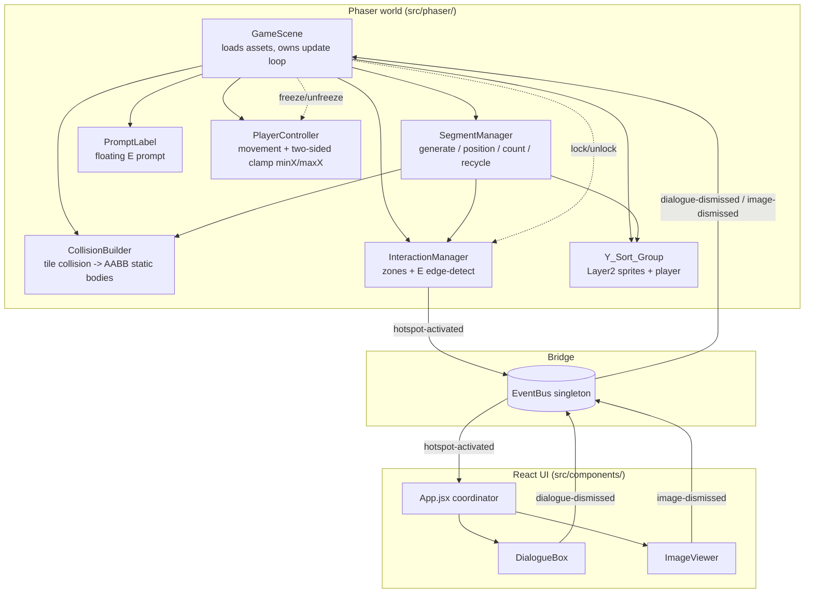
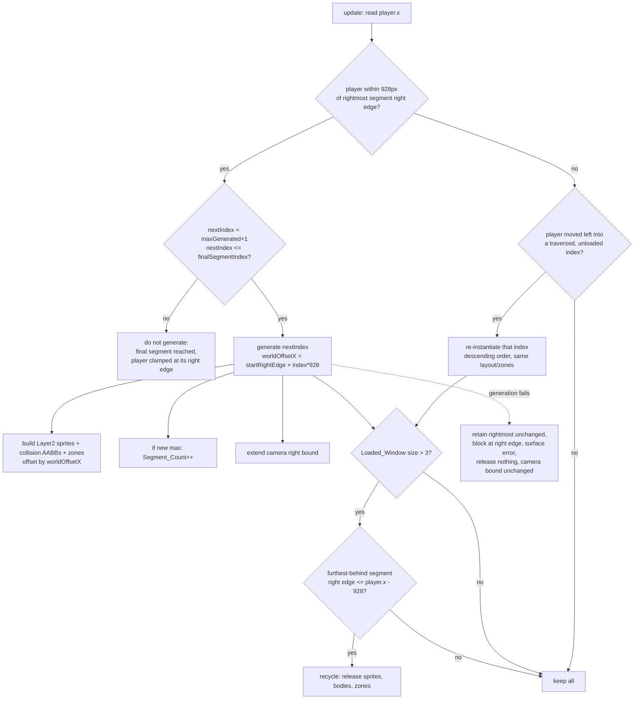

# Design Document: Infinite Hallway

## Overview

The Infinite Hallway feature (the established spec name) converts the Memories Museum from a single fixed room into a **bounded, finite** stitched gallery that reads as a walk through a relationship timeline, and simultaneously corrects the runtime so it loads the real authored maps and tilesets instead of the non-existent `madison` placeholders. The world is bounded on the **left** by the fixed start map and on the **right** by the final segment that holds the highest authored memory — the hallway extends only far enough to contain the last authored memory. Any frames in that final room beyond the last authored memory are **future** frames that, when activated, show a short future-memory note rather than a saved memory.

Three concerns drive the design:

1. **Asset correctness.** `GameScene` currently loads `madison-map.json` / `madison.png` and derives collision from a dedicated `collision` tile layer. Neither exists in the authored assets. The authored maps are Tiled `.tmx` files (`museum_start`, `museum_hallway`) using two tilesets (`museum_tileset` firstgid 1, `museum_decor` firstgid 41) with **per-tile collision object groups** and **no collision layer**. This feature adds an author-time **Map_Converter** step (Tiled `.tmx` → finite Tiled JSON) and rewrites `preload()`/`create()` to load the real assets and drive collision from per-tile shapes.

2. **Bounded, procedurally stitched hallway.** A new `SegmentManager` class generates copies of the hallway map to the right of the fixed start map as the player walks right, but only up to the **Final_Segment_Index** — the index of the segment holding the last authored memory, equal to `floor((N-1)/6)` for `N ≥ 1` and `0` when `N = 0` (where `N` is the Authored_Memory_Count). It never generates a segment index greater than `Final_Segment_Index`, keeps a bounded window of at most 3 instantiated segments, recycles segments that fall far enough behind, re-instantiates them in reverse order on the way back, and the player is clamped on **both** ends — at the start map's left edge and at the final segment's floor right edge. When `N = 0`, the hallway is exactly one segment (index 0) whose 6 zones are all future zones, with nothing generated to its right.

3. **Interaction redesign.** The `[E]` floating prompt, dedicated-key semantics (E = open, Space = advance/last-page dismiss, Esc = dismiss), and segment-local interaction zones replace the old Space/Enter-overlap `memory_hotspot` activation model. `HotspotManager` is replaced by an `InteractionManager` whose zones come from each segment's `Object Layer 1` and move with the segment.

The game stays a static, self-contained site with no backend. The Phaser↔React boundary remains the `EventBus` singleton, and the existing event names (`hotspot-activated`, `dialogue-dismissed`, `image-dismissed`) are preserved so the React coordinator (`App.jsx`) changes as little as possible.

### Design principles carried from the existing code

- **ES modules throughout**; Phaser managers are ES classes with JSDoc; React is functional components + hooks.
- **Feet-origin Y-sort.** Every sortable sprite and the player use origin `(0.5, 1)`; `depth = y` is re-applied every frame in `update()` for members of a sort group.
- **Pixel-perfect.** Integer camera zoom (2), `pixelArt: true`, `roundPixels: true` (already set in `config.js`).
- **Graceful asset failure.** The `_loadError` / `_displayError()` path is preserved and extended to the new assets.
- **Heavy media by URL.** Memory images are referenced by `imageUrl`, never bundled.

---

## Architecture

### Research notes informing the design

- **Tiled infinite maps store layer data in `<chunk>` elements** (visible in both `.tmx` files: `infinite="1"`, chunked CSV at negative chunk origins). Phaser's `tilemapTiledJSON` loader consumes **finite** (non-chunked) Tiled JSON most reliably, where each tile layer carries a single flat `data` array sized `width * height`. The Map_Converter therefore re-exports the maps as **finite** JSON (Tiled: Map → "Infinite" unchecked, or `tiled --export-map` to `.json` after toggling), collapsing the chunk grid into a flat `58 × 15` array anchored at `(0,0)`.
- **GID flags carry two separate concerns.** Some Tile Layer 2 cells contain values like `2147483673` and `2147483684` — these are Tiled flip/rotation bit flags OR'd onto the GID in the top 3 bits. A flagged GID encodes **two independent things** that must both be handled:
  - **(a) Which frame to draw** — resolved by masking off the top 3 bits with `gid & 0x1FFFFFFF` (the low 29 bits are the real tile index). Masking alone prevents the astronomically-wrong frame index that would otherwise crash or draw garbage.
  - **(b) Orientation** — the top 3 bits: `FLIPPED_HORIZONTALLY = 0x80000000`, `FLIPPED_VERTICALLY = 0x40000000`, `FLIPPED_DIAGONALLY = 0x20000000`. Masking for (a) **silently discards** orientation, so a mirrored decor tile would render un-mirrored. The flip MUST be applied at render time (via `setFlipX` / `setFlipY`), not just masked away.
  - The two flagged values decode as: `2147483673 = 0x80000019` ⇒ tile id `25` + horizontal flip; `2147483684 = 0x80000024` ⇒ tile id `36` + horizontal flip. **Only the horizontal-flip bit occurs in the current maps** (no vertical or diagonal flips are present); vertical and diagonal flips are handled defensively (see `GameScene._buildSortableLayer` and the Error Handling table) so a future map that introduces them does not crash.
- **Per-tile collision survives export.** Tiled stores tile-collision shapes in the tileset (`<tile id><objectgroup>…`), not the map. The embedded tilesets (`museum_tileset.tsx`, `museum_decor.tsx`) carry `objectgroup` polygons on specific tile ids. The converter must export tilesets **embedded** (or emit matching external `.json` tilesets) so the objectgroups travel into the runtime map JSON. Phaser exposes these as `tile.getCollisionGroup()` / `tileset.tileData[localId].objectgroup.objects` after `addTilesetImage`.
- **Collision shapes are polygons, not rectangles.** Requirement 6.4 mandates approximating each shape as its axis-aligned bounding box (AABB). The design computes an AABB by taking `min/max` of a polygon's points (offset by the object's `x,y`), or using `width/height` for rectangle objects (e.g. `museum_tileset` tile 12).

### High-level component diagram



### Open / advance / dismiss flow

```mermaid
sequenceDiagram
    participant Player
    participant GS as GameScene/InteractionManager
    participant EB as EventBus
    participant App
    participant Overlay as DialogueBox/ImageViewer

    Note over GS: each frame: overlap? + E rising edge?
    Player->>GS: press E while inside Interaction_Zone, overlay closed
    Note over GS: payload resolved by memoryIndex — manifest if < N, else future-memory note
    GS->>EB: emit hotspot-activated {id: `memory-{n}`, text, imageUrl}
    EB->>App: hotspot-activated
    App->>App: guard overlayActiveRef; open iff text or imageUrl
    App->>Overlay: render (freeze happens via GS listener)
    EB->>GS: (GS also listens) freeze player + lock InteractionManager
    Note over GS: E ignored while locked (Req 9.5)
    Player->>Overlay: press Space (not last page)
    Overlay->>Overlay: advance page (no dismiss)
    Player->>Overlay: press Space on last page / or Esc any page
    Overlay->>EB: emit dialogue-dismissed / image-dismissed
    EB->>App: dismissed -> clear overlay state
    EB->>GS: dismissed -> unfreeze + unlock within one frame
```

### Segment generation / recycling flow



### Layer / depth ordering (unchanged convention, extended to segments)

| Draw order | Contents | Depth |
|---|---|---|
| Bottom | `Tile Layer 1` floor + back wall (start map and every segment) | fixed low (`0`) |
| Middle (Y-sorted) | `Tile Layer 2` decor sprites + player, in `Y_Sort_Group` | `depth = feet world Y`, re-applied each frame |
| Top | `Prompt_Label` and any overhead | `>= OVERHEAD_DEPTH` (`10000`) |

Collision AABB static bodies are invisible (no draw) and carry no depth.

---

## Components and Interfaces

### New components

#### `src/phaser/SegmentManager.js`

Owns the lifecycle of hallway segments. It is pure-logic-first: all index/offset/window arithmetic is deterministic and unit/property-testable without a live Phaser scene; scene calls (building sprites, bodies, zones) are delegated to injected builders so the manager can be exercised with mocks exactly like the existing `HotspotManager` tests.

```js
/**
 * SegmentManager — generates, positions, counts, and recycles Hallway_Segments,
 * bounded on the right at Final_Segment_Index (the segment holding the last authored
 * memory). On build, delegates zone ordering + memory resolution (Zone_Index,
 * Memory_Index, authored-or-future payload) to the segment-build step — see
 * "Zone ordering and memory resolution".
 * Requirements: 3.1–3.9, 4.1–4.7, 5.1, 5.5, 10.4, 10.6, 12.1–12.7, 13.1, 13.2, 13.8
 */
export default class SegmentManager {
  /**
   * @param {object} deps
   * @param {number} deps.startRightEdgeX  world X of start-map floor right edge
   * @param {number} deps.segmentWidthPx   58 * 16 = 928
   * @param {number} deps.authoredMemoryCount  N — count of Memories_Manifest entries;
   *   finalSegmentIndex is derived from it as floor((N-1)/6) for N>=1, else 0 (Req 13.2).
   *   (A caller may instead inject deps.finalSegmentIndex directly.)
   * @param {number} [deps.finalSegmentIndex]  optional explicit bound; when omitted it is
   *   derived from authoredMemoryCount. No segment index > finalSegmentIndex is generated (Req 3.3, 13.1).
   * @param {number} [deps.maxLoaded=3]
   * @param {number} [deps.generateAheadPx=928]
   * @param {(index:number, worldOffsetX:number) => Segment} deps.buildSegment
   * @param {(segment:Segment) => void} deps.releaseSegment
   */
  constructor(deps) {}

  /** The rightmost segment index that can ever exist = floor((N-1)/6) for N>=1, else 0. (Req 13.2) */
  get finalSegmentIndex() {}

  /** Highest generated index + 1; 0 before any generation. (Req 4.1,4.6) */
  get segmentCount() {}

  /** @returns {Map<number, Segment>} instantiated segments by index. */
  get loadedWindow() {}

  /** World X of a segment index's left edge. offset = startRightEdge + index*width. */
  worldOffsetForIndex(index) {}

  /** Called each frame with the player's world X. Drives generate/recycle. */
  update(playerX) {}

  /** @returns {boolean} true if last generation attempt failed (Req 3.9). */
  get generationFailed() {}
}
```

Key rules encoded:
- `finalSegmentIndex = N >= 1 ? Math.floor((N - 1) / 6) : 0` (Req 13.2). When `N = 0`, `finalSegmentIndex = 0`, so the hallway is exactly one segment (index 0) whose 6 zones are all future zones, with nothing generated to its right (Req 13.8).
- `worldOffsetForIndex(0) = startRightEdgeX` (flush seam, zero gap — Req 3.1), `worldOffsetForIndex(n) = startRightEdgeX + n*928` (Req 3.5).
- Generate index `maxGenerated + 1` **only while** `maxGenerated < finalSegmentIndex` **and** `playerX >= rightmostRightEdge - generateAheadPx` (Req 3.2). No segment index `> finalSegmentIndex` is ever generated (Req 3.3, 13.1); once the rightmost index equals `finalSegmentIndex`, generate-ahead stops firing and no further segment is created to the right (Req 3.4).
- `segmentCount` increments by exactly 1 only when a strictly new maximum index is generated (Req 4.2, 4.3); leftward re-instantiation never changes it (Req 4.4). `segmentCount` is kept `<= finalSegmentIndex + 1` and never raised above it (Req 4.7).
- `loadedWindow.size <= maxLoaded` always; when a generation would exceed it, recycle the furthest-behind segment **only if** its right edge `<= playerX - 928` (Req 3.6, 3.7). If nothing is eligible, keep all (window may momentarily equal max; generation of a new one waits).
- Recycling calls `releaseSegment(segment)` which disposes Layer2 sprites, collision bodies, and zones (Req 3.8).
- Walking left re-instantiates missing indices in descending order using the same deterministic `worldOffsetForIndex` + a deterministic build (identical decor + zones per index — Req 5.1, 5.6). Never holds an index `< 0` (Req 5.5).
- On build failure, sets `generationFailed = true`, retains the current rightmost segment, releases nothing (Req 3.9).

#### `src/phaser/CollisionBuilder.js`

Translates per-tile collision object groups into arcade-compatible blocking regions. **Chosen approach: per-collidable-tile static arcade bodies** (a pooled static group of invisible rectangles sized to each tile's Collision_AABB), rather than Phaser's tilemap-layer `setCollisionByExclusion`.

Rationale for static bodies over tile-layer collision:
- The map has **no collision layer** and collision is defined **per tileset tile**, not per layer (Req 6.1, 6.6). Tile-layer collision would require a dedicated layer we intentionally do not create.
- Segments live at arbitrary world offsets and are created/destroyed at runtime; a static group of rectangles is trivial to offset by `worldOffsetX` (Req 6.7) and to release on recycle (Req 3.8). Tilemap-layer collision is awkward to reposition and pool per segment.
- Arcade physics resolves sprite-vs-static-body overlap directly via a single `collider` (Req 6.5), which is exactly the existing collision model (`physics.add.collider`).

```js
/**
 * CollisionBuilder — builds static AABB bodies from per-tile collision shapes.
 * Requirements: 6.1–6.8
 */
export default class CollisionBuilder {
  /** @param {Phaser.Scene} scene @param {Phaser.Physics.Arcade.StaticGroup} group */
  constructor(scene, group) {}

  /**
   * Classify a tileset tile by presence of a collision object group.
   * Absent OR unparseable => Floor_Tile (Req 6.2, 6.8). Present => Collision_Tile (Req 6.3).
   * @returns {'floor'|'collision'}
   */
  classifyTile(tilesetTileData) {}

  /**
   * Compute the axis-aligned bounding box enclosing a tile's collision shape(s),
   * in tile-local pixels. Rectangles use x/y/width/height; polygons use min/max of points. (Req 6.4)
   * @returns {{x:number,y:number,width:number,height:number}|null} null if floor/unparseable
   */
  tileLocalAABB(tilesetTileData) {}

  /**
   * For each collidable tile in a placed layer, add a static body at
   * worldOffsetX + tileCol*16 + localAABB.x (and Y likewise). (Req 6.7)
   * @returns {Phaser.Physics.Arcade.Sprite[]} created bodies (for later release)
   */
  buildForLayer(layerData, tileset, worldOffsetX) {}
}
```

**Flipped collision tiles (documented trade-off).** Tile id `36` (`museum_tileset`, local id 36) is a `Collision_Tile` — it carries a collision `objectgroup` — and it appears **H-flipped** in the maps (`2147483684 = 0x80000024`). Because `CollisionBuilder` approximates every collision shape as an axis-aligned bounding box (Req 6.4), the AABB **is not mirrored** when the source tile is flipped. For the symmetric-enough shapes in these maps a horizontal flip of an AABB is negligible, and the AABB approximation already discards sub-shape precision, so mirroring the box would add no meaningful accuracy. This is an **explicit, documented trade-off, not an oversight**: if pixel-accurate flipped collision is ever required, the fix is to mirror the tile-local AABB's `x` within the 16px cell when `flipH` is set — i.e. `localX' = 16 - (localX + width)` — (and the analogous `y` mirror for `flipV`). The frame-rendering flip (above) is independent of this and is always applied.

#### `src/phaser/InteractionManager.js` (replaces `HotspotManager.js`)

Same responsibilities as `HotspotManager` (own the open key, edge-detect it, emit `hotspot-activated`, provide a lock), but:
- The **open key is `E`** (not Space/Enter) (Req 9.1, 9.2, 9.13).
- Zones come from each **segment's `Object Layer 1`** rectangles/polygons, offset to the segment's world position and pooled with the segment — not standalone `memory_hotspot` objects.
- Zones carry a **memory payload resolved from the `Memories_Manifest`** via each zone's `Memory_Index` (`segIndex*6 + zoneIndex`), **not** from Tiled custom properties; see Data Models and "Zone ordering and memory resolution" below.

```js
/**
 * InteractionManager — owns Open_Key (E) detection and hotspot-activated emission.
 * Requirements: 8.1–8.5 (overlap state), 9.1–9.5, 9.13, 9.14, 12.4, 12.5, 12.6, 13.5
 */
export default class InteractionManager {
  /** @param {Phaser.Scene} scene @param {object} eventBus */
  constructor(scene, eventBus) {}

  /**
   * Register a segment's zones (already world-offset). Each InteractionZone already
   * carries its resolved {zoneIndex, memoryIndex, id, payload} from the segment-build
   * step (manifest resolution happened there — see "Zone ordering and memory resolution").
   */
  addZones(zones) {}

  /** Remove a segment's zones on recycle (Req 3.8). */
  removeZones(zones) {}

  /** @returns {boolean} true if player overlaps any registered zone (drives Prompt_Label). */
  isPlayerOverlappingZone(player) {}

  /**
   * Each frame: if unlocked AND E rising edge AND overlapping a zone, emit
   * hotspot-activated with that zone's resolved payload (authored Memories_Manifest entry
   * for memoryIndex < N, or the non-empty Future_Memory_Overlay payload for memoryIndex >= N
   * — Req 12.4, 12.5, 12.6, 13.5). Both authored and future payloads are non-empty and
   * therefore open an overlay and freeze. Edge-detected so one emit per press. (Req 9.3)
   * Never emits on Space/Enter/Esc (Req 9.2). No-op while locked (Req 9.5).
   */
  checkInteraction(player) {}

  /** Lock while an overlay is open. */
  setLocked(locked) {}
}
```

#### Zone ordering and memory resolution (segment-build responsibility)

Zone-index assignment and memory resolution live in the **segment-build step** (invoked by `SegmentManager` via its injected `buildSegment`, which reads the manifest), so that a recycled/re-instantiated segment at the same `Segment_Index` always resolves identically (Req 5.6, 12.7) and the arithmetic stays pure and testable. When a segment is built:

1. Take the 6 `Object Layer 1` objects and **sort** them by `(x, then y, then Tiled object id)`, assigning `zoneIndex` `0..5` by ascending local x (ties by ascending y, then ascending id) — a deterministic bijection onto `0..5` (Req 12.1, 12.2).
2. Compute `memoryIndex = segIndex * 6 + zoneIndex` (Req 12.3).
3. Resolve the payload by the **authored-vs-future split** keyed on `N` (Authored_Memory_Count) and set `id = \`memory-{memoryIndex}\``: when `memoryIndex < N`, take the `Memories_Manifest` entry (`text`, `imageUrl`) (Req 12.4); when `memoryIndex >= N` (a Future_Zone), emit the constant Future_Memory_Overlay payload `text: ["A future memory, not yet saved ❤"]`, `imageUrl: null` — a **non-empty** payload that opens an overlay and freezes (Req 12.6, 13.5).
4. Attach `{ zone, zoneIndex, memoryIndex, id, payload }` to the segment and register the zones with the `InteractionManager`.

A small **pure, unit/property-testable** helper carries the arithmetic so it needs no live scene:

```js
/**
 * resolveZonePayload — pure resolver for a single zone's memory, bounded by N.
 * memoryIndex = segIndex*6 + zoneIndex. For memoryIndex < N the payload is the authored
 * Memories_Manifest entry; for memoryIndex >= N (a Future_Zone) the payload is the constant
 * Future_Memory_Overlay payload (non-empty: it opens an overlay and freezes the Player).
 * Requirements: 12.4, 12.5, 12.6, 13.5
 * @param {number} segIndex   0-based segment index
 * @param {number} zoneIndex  0..5
 * @param {Map<number,MemoryEntry>|Record<number,MemoryEntry>} manifest
 * @param {number} authoredMemoryCount  N — number of authored memories (manifest size)
 * @returns {{id:string, memoryIndex:number, payload:MemoryPayload}}
 */
export function resolveZonePayload(segIndex, zoneIndex, manifest, authoredMemoryCount) {
  const memoryIndex = segIndex * 6 + zoneIndex;
  const id = `memory-${memoryIndex}`;
  let payload;
  if (memoryIndex < authoredMemoryCount) {
    // Authored memory from the manifest (Req 12.4).
    const entry = (manifest instanceof Map ? manifest.get(memoryIndex) : manifest[memoryIndex]);
    payload = { id, text: entry?.text ?? [], imageUrl: entry?.imageUrl ?? null };
  } else {
    // Future_Zone — constant future-memory payload (Req 12.6, 13.5).
    payload = { id, text: [FUTURE_MEMORY_TEXT], imageUrl: null };
  }
  return { id, memoryIndex, payload };
}

/**
 * assignZoneIndices — pure: sort 6 zone descriptors by (x, y, id) -> zoneIndex 0..5.
 * Requirements: 12.1, 12.2
 * @param {{x:number,y:number,id:number}[]} objects
 * @returns {{id:number, zoneIndex:number}[]} each input object tagged with its rank
 */
export function assignZoneIndices(objects) { /* stable sort by x,y,id then index */ }
```

This helper lives alongside the segment-build logic (co-located with `SegmentManager`, or a small `src/phaser/memoryResolve.js` module imported by it), and the manifest is imported from `src/data/memories.js`.

#### `src/phaser/PromptLabel.js` (or `InteractionPromptManager`)

A thin wrapper around a Phaser `Text`/`Container` showing `[E]`.

```js
/**
 * PromptLabel — floating [E] prompt pinned above the player.
 * Requirements: 8.1–8.5
 */
export default class PromptLabel {
  /** @param {Phaser.Scene} scene @param {number} [offsetY=-8] pixels above player top */
  constructor(scene, offsetY) {}

  /** Show/hide. Depth fixed at >= OVERHEAD_DEPTH so decor never occludes it (Req 8.5). */
  setVisible(visible) {}

  /** Reposition above the player's top edge each frame (Req 8.2). */
  follow(player) {}
}
```

Visibility rule applied in `GameScene.update()`:
`promptLabel.setVisible(interactionManager.isPlayerOverlappingZone(player) && !overlayOpen)` (Req 8.1, 8.3, 8.4).

#### Map_Converter (author-time asset step)

Not a runtime module. A documented build/author step plus committed output:

- **Input:** `Front-end/public/assets/maps/museum_start.tmx`, `museum_hallway.tmx` (infinite/chunked).
- **Process:** In Tiled, toggle Map → Properties → *Infinite* **off** (collapsing chunks to a flat `58×15` grid anchored at `(0,0)`), ensure tilesets are **embedded** so per-tile collision object groups export, then export to Tiled JSON. Equivalent headless: `tiled --export-map museum_start.tmx museum_start.json` after the infinite toggle.
- **Output location:** `Front-end/public/assets/maps/museum_start.json` and `museum_hallway.json` (Req 1.1, 1.2). The `.tmx` sources remain in the repo for future authoring.
- **Invariants preserved:** `Tile Layer 1`, `Tile Layer 2`, `Object Layer 1`, and each tileset tile's `objectgroup` collision data (Req 1.1, 1.2). The converter documentation notes that GID flip flags may appear and are masked at runtime.

This is documented in `docs/` and referenced by the asset steering note (naming drift). A follow-up task may script the conversion, but a committed JSON is sufficient for the static site.

### Modified components

#### `src/phaser/GameScene.js`

- **`preload()`**: remove all `madison` references (Req 1.6). Load `assets/maps/museum_start.json` and `assets/maps/museum_hallway.json` via `tilemapTiledJSON` (Req 1.3). Load `museum_tileset` and `museum_decor` images with keys equal to the tileset names (Req 1.4). Keep the player spritesheet load and the 10s sprite-load timeout. Keep the `loaderror` → `_loadError` / `_errorMessage` path, extended to name the missing tileset (Req 1.7, 11.1, 11.2, 11.3).
- **`create()`**: if `_loadError`, display error and build nothing (Req 11.4). Build the start map's `Tile Layer 1` as a fixed-low-depth layer; explode `Tile Layer 2` into `Y_Sort_Group` sprites (reusing the `_buildSortableLayer` pattern, now masking GID flags, applying flips, and keyed by the correct tileset image — see below). `addTilesetImage('museum_tileset','museum_tileset')` and `addTilesetImage('museum_decor','museum_decor')`; if either returns null or name mismatches, display a readable missing-tileset error (Req 1.5, 1.7). Instantiate `CollisionBuilder`, `SegmentManager`, `InteractionManager`, `PromptLabel`. Spawn player from `player_spawn` with left-of-everything fallback (Req 2.x). Camera zoom 2, follow player, left bound at start-map left edge, right bound grows with segments but is **capped at the final segment's right edge**; once the final segment (index `finalSegmentIndex`) exists the right bound is fixed there and never extended further (Req 10.x, 10.4, 13.4). Subscribe to `hotspot-activated` (freeze + lock), `dialogue-dismissed` / `image-dismissed` (unfreeze + unlock within one frame — Req 9.12).
- **`_buildSortableLayer()` (Tile Layer 2 decor)**: for each `Tile Layer 2` cell with raw GID `gid`, the builder MUST decode the GID into a frame plus an orientation before creating a sprite:
  1. **Frame:** `const frame = gid & 0x1FFFFFFF`. If `frame <= 0`, the cell is empty (`-1`/`0` or a masked-to-empty value) — **skip it, create no sprite**.
  2. **Orientation bits:** `const flipH = (gid & 0x80000000) !== 0; const flipV = (gid & 0x40000000) !== 0; const flipD = (gid & 0x20000000) !== 0;`
  3. **Create the sprite** with `add.image(x, y, tilesetImageKey, frameLocalId)` at feet origin `(0.5, 1)` (unchanged), then apply the orientation: `sprite.setFlipX(flipH)` and `sprite.setFlipY(flipV)`. Add it to the `Y_Sort_Group`; per-frame `depth = y` Y-sort behavior is **unchanged**.
  4. **Diagonal flip (`flipD`)** does not occur in the current maps. It is handled **defensively**: log a warning and ignore it (no rotation applied — `setFlipX`/`setFlipY` alone cannot express a diagonal/transpose). This is a **documented limitation**: if a future map introduces diagonal flips, the tile will render upright rather than transposed, and full support would require a rotation/transform beyond `setFlipX`/`setFlipY`.

  This resolves both concerns the GID carries: masking fixes the frame, `setFlipX`/`setFlipY` apply the flip, so H-flipped decor (tile ids 25 and 36 in the current maps) renders mirrored as authored.
- **`update()`**: `playerController.update()`; `segmentManager.update(player.x)`; re-depth every `Y_Sort_Group` member to its `y` (Req 7.3); `promptLabel.follow(player)` + visibility rule; `interactionManager.checkInteraction(player)`; update camera right bound if a new segment generated (capped at the final segment's right edge — Req 10.4, 13.4); track `overlayOpen` (set by the event listeners) for the prompt + lock gates.
- Drops `collisionLayer` / `setCollisionByExclusion` entirely (Req 6.6).

#### `src/phaser/PlayerController.js`

- Add a **two-sided clamp** (Req 5.3, 5.4 for the left edge; Req 13.3 for the right edge). The controller already stops the player; inject **both** `minX` (start-map floor left edge) and `maxX` (final segment floor right edge, minus the player half-width as appropriate so the sprite body stops at the edge). Each `update()` after velocity resolution, clamp `sprite.x = Math.min(Math.max(sprite.x, minX), maxX)`; zero any **leftward** velocity when `sprite.x <= minX` and zero any **rightward** velocity when `sprite.x >= maxX`, so a leftward input at `minX` and a rightward input at `maxX` both leave the Player's X unchanged. World bounds `setCollideWorldBounds(true)` is kept but the world's left and right bounds are also pinned to `minX`/`maxX` so they agree. The right clamp (`maxX`) mirrors the left clamp (`minX`) — they are the two consistent ends of the bounded hallway. `maxX` is set once the final segment (index `finalSegmentIndex`) exists; the camera right bound (Req 10.4, 13.4) is capped at the same edge. No other movement behavior changes.

#### `src/components/DialogueBox.jsx`

- Change key handling to the new semantics (Req 9.8–9.11): **Space** advances when not on the last page and dismisses (emitting `dialogue-dismissed` via `onDismiss`) on the last page; **Esc** dismisses at any page; **Enter no longer advances or dismisses** (Req 9.10). Keep the 300ms debounce after becoming visible. The component still renders paged text and the "more pages" indicator.

#### `src/components/ImageViewer.jsx`

- **Space** dismisses (single page), **Esc** dismisses; **Enter removed** (Req 9.9, 9.11). Keep the close button and the `onError` image fallback.

#### `src/App.jsx`

- Minimal change. It already: guards double-activation with `overlayActiveRef` (Req 9.5 on the React side), opens only when `text` or `imageUrl` is present (Req 9.6, 9.7), and emits `dialogue-dismissed` / `image-dismissed`. No structural change is required; it continues to exchange data only through `EventBus` (Req 9.14). (If both dialogue and image are shown, Esc/last-page Space dismiss them per existing coordinator logic.)

#### `src/phaser/EventBus.js`

- Unchanged. Remains the sole Phaser↔React channel (Req 9.14) with the existing `hotspot-activated`, `dialogue-dismissed`, `image-dismissed` names.

---

## Data Models

### Segment descriptor

```js
/**
 * @typedef {object} Segment
 * @property {number} index           0-based index; 0 is adjacent to the start map (Req 4.5)
 * @property {number} worldOffsetX     world X of the segment's left edge = startRightEdge + index*928
 * @property {Phaser.GameObjects.Image[]} layer2Sprites  feet-origin decor sprites in the Y_Sort_Group
 * @property {Phaser.Physics.Arcade.Sprite[]} collisionBodies  invisible static AABB bodies
 * @property {InteractionZone[]} zones  interaction zones offset to world position
 */
```

### Interaction zone + memory payload

```js
/**
 * @typedef {object} MemoryPayload
 * @property {string} id            stable identifier for the memory
 * @property {string[]} text        0 or more dialogue pages (Req 9.1)
 * @property {string|null} imageUrl URL string or null (Req 9.1)
 */

/**
 * @typedef {object} InteractionZone
 * @property {Phaser.GameObjects.Zone} zone  static arcade overlap zone at world position
 * @property {number} zoneIndex    0..5 rank by ascending local x (ties: y, then Tiled id) (Req 12.2)
 * @property {number} memoryIndex  global 0-based memory number = segIndex*6 + zoneIndex (Req 12.3)
 * @property {string} id           stable identifier `memory-{memoryIndex}` (Req 12.5)
 * @property {MemoryPayload} payload  resolved at build time: authored manifest entry for
 *   memoryIndex < N, or the Future_Memory_Overlay payload for memoryIndex >= N (Req 12.4, 12.6, 13.5)
 */
```

The zone no longer carries an inline authored payload; it carries its `zoneIndex`, `memoryIndex`, `id`, and a `payload` resolved at build time by the **authored-vs-future split** (see below).

**Payload sourcing (design decision).** Interaction zones do **not** read Tiled custom properties, and there is **no per-segment placeholder**. Memory content is sourced from a static in-app `Memories_Manifest` keyed by `Memory_Index`, split on the Authored_Memory_Count `N` (Req 12.4, 12.6, 12.8, 13.5):

- When a segment is built, its 6 `Object Layer 1` objects are ranked into `Zone_Index` 0..5 (see "Zone ordering and memory resolution" under Components), each zone's `Memory_Index` is computed as `segIndex * 6 + zoneIndex` (Req 12.3), and its payload is resolved with `id = \`memory-{memoryIndex}\`` (Req 12.1–12.5).
- **Authored zone (`memoryIndex < N`):** the payload is the `Memories_Manifest` entry (`text` pages + `imageUrl`) for that `Memory_Index` (Req 12.4).
- **Future zone (`memoryIndex >= N`):** the payload is the constant **Future_Memory_Overlay** payload `{ id: \`memory-{memoryIndex}\`, text: ["A future memory, not yet saved ❤"], imageUrl: null }`. This is a **non-empty** payload: per Req 9.6 / 12.6 / 13.5 it **opens an overlay and freezes** the Player (just like an authored memory), and the `[E]` prompt still appears (Req 8). Because generation stops at `Final_Segment_Index` (Req 3.3, 13.1), future zones occur **only within the final segment**; there is no in-world Interaction_Zone whose `Memory_Index` lies beyond the final segment, so the old "empty payload, no overlay, no freeze" case is superseded for in-world zones. The general freeze-gating in Req 9.6/9.7 still holds — a payload with no `text` and no non-empty `imageUrl` would not freeze — but no in-world zone ever produces such an empty payload now.
- Because `Memory_Index` folds in the `Segment_Index`, identical hallway-map copies resolve to **different** memories per segment, and re-entering the same `Segment_Index` always resolves the same `Memory_Index` → same content (authored entry or future note) (Req 12.7, consistent with Req 5.6).

**Authoring follow-up (resolved).** The previously-open question — do memories repeat or vary per segment? — is **resolved**: memories **vary per segment** via `Memory_Index = segIndex*6 + zoneIndex`, with content supplied by the `Memories_Manifest`. The remaining authoring task is simply to **populate the manifest** (`text` pages + `imageUrl` per `Memory_Index`). Unauthored trailing zones in the final segment (those with `Memory_Index >= N`) are **future zones**: they show the Future_Memory_Overlay note ("A future memory, not yet saved ❤") and freeze the Player, rather than showing nothing. No backend is introduced.

### Memories manifest

```js
/**
 * @typedef {object} MemoryEntry
 * @property {string[]} text    dialogue pages
 * @property {string|null} imageUrl
 */

// Memories_Manifest: Map<number, MemoryEntry> or a plain array indexed by Memory_Index.
// A static module (no network) exporting the manifest, e.g. Front-end/src/data/memories.js:
//   export const MEMORIES = { 0: { text: [...], imageUrl: '...' }, 1: {...}, ... }
// Referenced by SegmentManager (at segment build) / InteractionManager; never fetched.
```

- **Location:** a new static module under `src/`, e.g. `Front-end/src/data/memories.js`, exporting the manifest (`MEMORIES`). It is imported — not fetched — keeping the static, backend-free model (Req 12.8).
- **Shape:** a `Map<number, MemoryEntry>` or plain object/array keyed/indexed by `Memory_Index`, holding exactly `N` authored entries at indices `0..N-1`.
- **Authored_Memory_Count (N):** the number of manifest entries. It drives `finalSegmentIndex = floor((N-1)/6)` (for `N >= 1`, else 0) and the authored-vs-future split in `resolveZonePayload`. Indices `>= N` are future zones (Req 13.2, 13.5).
- **Emptiness rule:** an authored entry counts as "content present" only if it has at least one non-empty `text` page or a non-null, non-empty `imageUrl` — matching the freeze gate in Req 9.6/9.7.

### Future memory overlay (bounded-hallway constant)

```js
/**
 * FUTURE_MEMORY_TEXT — the single dialogue page shown for a Future_Zone.
 * EXACT string (must not change): "A future memory, not yet saved ❤"
 */
export const FUTURE_MEMORY_TEXT = 'A future memory, not yet saved ❤';

/**
 * Future_Memory_Overlay payload — a constant, NON-empty dialogue payload emitted when a
 * zone's Memory_Index >= N. It opens an overlay and freezes the Player (Req 12.6, 13.5).
 * The `id` is filled per-zone as `memory-{Memory_Index}`.
 * @type {{ text: string[], imageUrl: null }}
 */
export const FUTURE_MEMORY_OVERLAY = { text: [FUTURE_MEMORY_TEXT], imageUrl: null };
```

- **Location:** co-located with the memory resolver / manifest (e.g. `src/data/memories.js` or `src/phaser/memoryResolve.js`), imported by `resolveZonePayload`.
- **Non-empty:** because `text` has one page, this payload satisfies the Req 9.6 freeze gate — a future zone freezes the Player and opens the Overlay exactly like an authored memory, and is dismissed the same way.

### Loaded window + count

```js
/**
 * @typedef {object} SegmentManagerState
 * @property {Map<number, Segment>} loadedWindow  index -> Segment, size <= maxLoaded (3) (Req 3.6)
 * @property {number} segmentCount                highest generated index + 1; 0 initially (Req 4.1,4.6)
 * @property {number} maxGeneratedIndex           -1 before any generation
 * @property {boolean} generationFailed           (Req 3.9)
 */
```

### Collision AABB

```js
/**
 * @typedef {object} CollisionAABB
 * @property {number} x       world X (tile-local x + col*16 + segment worldOffsetX) (Req 6.7)
 * @property {number} y       world Y (tile-local y + row*16)
 * @property {number} width
 * @property {number} height
 */
```

### Map / tileset constants

- Tile grid: 16px. Map: `58 × 15` tiles ⇒ `928 × 240` px per map/segment.
- Tilesets: `museum_tileset` firstgid 1 (40 tiles, collision on local ids 12, 24, 26, 27, 28, 35, 36, 37); `museum_decor` firstgid 41 (24 tiles, collision on local ids 7 and 13).
- GID flip-flag mask: `gid & 0x1FFFFFFF`.

---

## Correctness Properties

*A property is a characteristic or behavior that should hold true across all valid executions of a system — essentially, a formal statement about what the system should do. Properties serve as the bridge between human-readable specifications and machine-verifiable correctness guarantees.*

These 18 properties mirror the Correctness Properties enumerated in `requirements.md`. Each is implemented by exactly one fast-check property test (minimum 100 iterations) against the pure logic of `SegmentManager`, `CollisionBuilder`, `InteractionManager`, `PlayerController`, the memory resolver (`resolveZonePayload` / `assignZoneIndices`), and the Y-sort/prompt predicates, using Phaser mocks in the style of the existing `__tests__`.

### Property 1: Left-boundary invariant

*For all* sequences of movement inputs, the Player's world X SHALL never be less than the world X of the left edge of the Start_Map floor, and a leftward input applied at that edge SHALL leave the Player's X unchanged.

**Validates: Requirements 5.3, 5.4**

### Property 2: Floor continuity invariant

*For all* pairs of adjacent segments (and the Start_Map–segment-0 seam), the left edge world X of segment `n` SHALL equal the right edge world X of segment `n-1` (start-map right edge for `n = 0`) with zero gap and zero overlap, and the floor row Y SHALL be identical.

**Validates: Requirements 3.1, 3.5, 5.2**

### Property 3: Segment-count monotonicity

*For all* movement paths, the Segment_Count SHALL be non-decreasing, and SHALL increase (by exactly 1) only on the step that generates a strictly new maximum segment index.

**Validates: Requirements 4.2, 4.3**

### Property 4: Segment-count equals max index + 1

*For all* movement paths, the Segment_Count SHALL equal the highest generated segment index plus one (and SHALL be 0 before any segment is generated).

**Validates: Requirements 4.5, 4.6**

### Property 5: Bounded generation

*For all* movement paths, no generated segment index SHALL exceed the Final_Segment_Index (`floor((N-1)/6)` for `N >= 1`, else `0`), and the Segment_Count SHALL never exceed `Final_Segment_Index + 1`.

**Validates: Requirements 3.3, 4.7, 13.1**

### Property 6: Right-boundary invariant

*For all* sequences of movement inputs, the Player's world X SHALL never exceed the world X of the right edge of the final segment's floor, and a rightward input applied at that edge SHALL leave the Player's X unchanged (mirror of the left-boundary invariant).

**Validates: Requirements 13.3**

### Property 7: Loaded-window bound

*For all* movement paths, the number of concurrently instantiated Hallway_Segments SHALL never exceed the Loaded_Window maximum of 3.

**Validates: Requirements 3.6, 3.7**

### Property 8: Return-path consistency

*For all* right-then-left movement paths, the sequence of segment indices encountered while walking left SHALL be the reverse of the sequence encountered while walking right, terminating at the Start_Map, and no instantiated segment index SHALL ever be less than 0.

**Validates: Requirements 5.1, 5.5**

### Property 9: Prompt visibility iff zone overlap and no overlay

*For all* combinations of Player position and overlay state, the Prompt_Label SHALL be visible if and only if the Player overlaps at least one Interaction_Zone AND no Overlay is open.

**Validates: Requirements 8.1, 8.3, 8.4**

### Property 10: Single activation per press

*For all* Open_Key (`E`) hold durations (frame sequences of held/released), at most one `hotspot-activated` event SHALL be emitted per discrete Open_Key press cycle.

**Validates: Requirements 9.3**

### Property 11: No activation outside zones

*For all* Player positions that overlap no Interaction_Zone, no Open_Key (`E`) press SHALL emit a `hotspot-activated` event.

**Validates: Requirements 9.4**

### Property 12: No re-open while overlay open

*For all* Open_Key (`E`) presses that occur while an Overlay is open (manager locked), no new `hotspot-activated` event SHALL be emitted.

**Validates: Requirements 9.5**

### Property 13: Advance never opens

*For all* Advance_Key (`Space`) presses that occur while no Overlay is open, the Game_Scene SHALL emit no `hotspot-activated` event.

**Validates: Requirements 9.2**

### Property 14: Collision classification

*For all* tiles, a tile with no (or unparseable) collision object group SHALL be classified as a Floor_Tile and remain fully occupiable, a tile with a collision object group SHALL be classified as a Collision_Tile with a blocking Collision_AABB that fully encloses its collision shape, and each Collision_AABB's world position SHALL equal its tile-local AABB offset by the segment world offset.

**Validates: Requirements 6.2, 6.3, 6.4, 6.7, 6.8**

### Property 15: Camera never reveals pre-start space

*For all* camera follow states, with the left bound set at the Start_Map left edge, the camera's visible left edge SHALL never be less than the left edge of the Start_Map.

**Validates: Requirements 10.3**

### Property 16: Memory-index determinism

*For all* segment indices `s` (≥ 0) and all `Zone_Index` values `z` in `0..5`, the resolved `Memory_Index` SHALL equal `s * 6 + z`, and resolving the same `(s, z)` again (re-instantiating the same `Segment_Index`) SHALL yield the identical `Memory_Index`, `id` (`memory-{Memory_Index}`), and payload.

**Validates: Requirements 12.3, 12.7**

### Property 17: Zone ordering determinism

*For all* sets of 6 distinct zone objects with arbitrary local `x`/`y`/Tiled `id` (including equal-`x` ties), assigning `Zone_Index` by ascending `x` (ties broken by ascending `y`, then ascending `id`) SHALL be a bijection onto `{0,1,2,3,4,5}` — each `Zone_Index` used exactly once — and SHALL be stable across repeated assignment.

**Validates: Requirements 12.2**

### Property 18: Future zone opens future-memory overlay

*For all* `Memory_Index` values greater than or equal to the Authored_Memory_Count (`N`), the resolved payload's `text` SHALL equal `["A future memory, not yet saved ❤"]` and `imageUrl` SHALL be `null` — a non-empty payload (with `id = \`memory-{Memory_Index}\``) that opens an Overlay and freezes the Player.

**Validates: Requirements 12.6, 13.5**

---

## Error Handling

| Condition | Requirement | Behavior |
|---|---|---|
| Map JSON fails to load | 11.1 | `loaderror` sets `_loadError` + `_errorMessage = "Error: Map could not be loaded"`; `create()` renders the on-canvas error and builds nothing. |
| Tileset image fails to load / name mismatch on `addTilesetImage` | 1.7, 11.2 | `_errorMessage` names the missing tileset (`"Error: Missing tileset: museum_decor"`); scene is not built. |
| Player spritesheet missing within 10s timeout | 11.3 | Existing timeout path sets `_playerSpriteError` + error text. |
| Any load error present | 11.4 | No layers built, no player spawned, no segments generated. |
| Segment generation / positioning fails | 3.9, 10.6 | `SegmentManager.generationFailed = true`; retain current rightmost segment; block player at its right edge; release no loaded segment; leave camera right bound unchanged; surface an error indication (console warn + optional on-canvas banner). |
| Tile references absent/unparseable collision data | 6.8 | `CollisionBuilder.classifyTile` returns `'floor'`; no body created; remaining segment continues building (no throw). |
| Tiled GID flip flags on Layer2 tiles | research note, 7.x | Mask with `gid & 0x1FFFFFFF` for the frame; apply orientation via `setFlipX((gid & 0x80000000) !== 0)` and `setFlipY((gid & 0x40000000) !== 0)`; a masked index `<= 0` is treated as empty (no sprite); diagonal flip (`gid & 0x20000000`) is logged and ignored (documented limitation — tile renders upright). |
| Zone's Memory_Index is beyond the authored range (`memoryIndex >= N`) — a Future_Zone in the final segment | 12.6, 13.5 | Resolve the Future_Memory_Overlay payload `{id: \`memory-{n}\`, text: ["A future memory, not yet saved ❤"], imageUrl: null}`; E emits, the overlay **opens** and the player **freezes** (non-empty payload, Req 9.6). Since generation stops at Final_Segment_Index, no in-world zone lies beyond the final segment, so there is no empty-payload / no-overlay case for in-world zones. |
| Image URL broken at display time | existing | `ImageViewer` `onError` shows the "No image available" fallback. |

---

## Testing Strategy

The suite keeps the existing dual approach — **example-based** tests (Vitest + `@testing-library/react` + jsdom) for concrete behavior and integration points, and **property-based** tests (fast-check, ≥100 iterations) for universal invariants — and mirrors the current file conventions: tests in `__tests__/` beside the code, named `*.test.{js,jsx}`, with property variants `*.property.test.*`. Phaser is mocked at module level (`vi.mock('phaser', …)`) exactly as in `GameScene.boundary.property.test.js` and `HotspotManager.activation.property.test.js`.

### Property-based tests (fast-check)

Each property above maps to one property test file, tagged with a header comment in the existing format:
`// Feature: infinite-hallway, Property {N}: {property text}` plus `**Validates: Requirements X.Y**`.

| Property | Target module | New test file |
|---|---|---|
| 1 Left-boundary | `PlayerController` | `PlayerController.clamp.property.test.js` (covers both bounds) |
| 2 Floor continuity | `SegmentManager.worldOffsetForIndex` | `SegmentManager.continuity.property.test.js` |
| 3 Count monotonicity | `SegmentManager` | `SegmentManager.count.property.test.js` |
| 4 Count = maxIndex+1 | `SegmentManager` | `SegmentManager.count.property.test.js` (second property block) |
| 5 Bounded generation | `SegmentManager` (finalSegmentIndex guard) | `SegmentManager.bounded.property.test.js` |
| 6 Right-boundary | `PlayerController` (maxX clamp) | `PlayerController.clamp.property.test.js` (second property block) |
| 7 Loaded-window bound | `SegmentManager.update` | `SegmentManager.window.property.test.js` |
| 8 Return-path consistency | `SegmentManager` | `SegmentManager.returnPath.property.test.js` |
| 9 Prompt visibility | prompt predicate / `InteractionManager.isPlayerOverlappingZone` | `PromptLabel.visibility.property.test.js` |
| 10 Single activation per press | `InteractionManager.checkInteraction` | `InteractionManager.activation.property.test.js` |
| 11 No activation outside zones | `InteractionManager` | `InteractionManager.noZone.property.test.js` |
| 12 No re-open while locked | `InteractionManager` | `InteractionManager.lock.property.test.js` |
| 13 Advance never opens | `InteractionManager` (Space ignored) | `InteractionManager.spaceNoOpen.property.test.js` |
| 14 Collision classification + AABB + offset | `CollisionBuilder` | `CollisionBuilder.classification.property.test.js` |
| 15 Camera left bound | GameScene camera bound helper | `GameScene.camera.property.test.js` (extend existing) |
| 16 Memory-index determinism | `resolveZonePayload` (pure resolver) / `SegmentManager` zone-build | `MemoryIndex.determinism.property.test.js` |
| 17 Zone ordering determinism | `assignZoneIndices` (pure) | `ZoneOrdering.property.test.js` |
| 18 Future zone opens future-memory overlay | `resolveZonePayload` (pure resolver) | `FutureMemory.property.test.js` (replaces `ManifestFallback.property.test.js`) |

Representative fast-check arbitraries:
- **Movement paths:** `fc.array(fc.constantFrom('left','right'), {maxLength: 200})` reduced into a running `playerX` fed to `SegmentManager.update`, recording window size, indices entering/leaving, and `segmentCount`. For **bounded generation** and **right-boundary** properties the path runs against a `SegmentManager`/`PlayerController` configured with a random `authoredMemoryCount` `N` (`fc.nat`) → `finalSegmentIndex`, asserting no generated index exceeds `finalSegmentIndex`, `segmentCount <= finalSegmentIndex + 1`, and `playerX` never exceeds the final segment's floor right edge (nor drops below `minX`).
- **Tile definitions:** `fc.oneof` of `{ no objectgroup }`, `{ rectangle object }`, `{ polygon points }`, and `{ malformed objectgroup }` to exercise classify → AABB → world offset.
- **Key frame sequences:** `fc.array(fc.boolean())` as per-frame "E held" / "Space held" states to validate edge-detection emit counts.
- **Prompt states:** `fc.record({ overlaps: fc.boolean(), overlayOpen: fc.boolean() })`.
- **Zone objects (ordering).** `fc.array` of exactly 6 **distinct** `{ x, y, id }` records (`fc.integer` for each field), with a generator variant that forces equal-`x` ties to exercise the `(x, y, id)` tie-break, fed to `assignZoneIndices`; assert the resulting `zoneIndex` set equals `{0,1,2,3,4,5}` and is stable across repeated calls.
- **Segment / zone indices + manifests (memory resolution).** `segIndex = fc.nat()`, `zoneIndex = fc.integer({min:0,max:5})`, a manifest `fc.dictionary(fc.nat(), fc.record({ text: fc.array(fc.string()), imageUrl: fc.option(fc.webUrl(), {nil:null}) }))`, and an `authoredMemoryCount` `N = fc.nat()`; feed to `resolveZonePayload(segIndex, zoneIndex, manifest, N)` to check the index formula, `id` format, authored-manifest mirroring for `memoryIndex < N`, and — for the **future-zone** property — that every `memoryIndex >= N` yields `text === ["A future memory, not yet saved ❤"]` and `imageUrl === null` (a non-empty, overlay-opening, freeze-inducing payload).
- **GID decoding (optional small property test).** Over random GIDs (`fc.integer`, a base `fc.integer({min:1,max:64})` id OR'd with a random subset of the three flip bits), assert the decode helper is total and consistent: the computed frame always equals `gid & 0x1FFFFFFF`, `flipX` always equals `(gid & 0x80000000) !== 0`, and `flipY` always equals `(gid & 0x40000000) !== 0`. Named `GameScene.gidDecode.property.test.js` to match the `*.property.test.js` convention. (GID-flags research note; supports Req 7.1, 7.2)

### Example-based tests (Vitest / Testing Library)

- **Asset conversion (schema).** `maps.conversion.test.js`: load the committed `museum_start.json` / `museum_hallway.json` and assert they are finite (flat `data` arrays, `infinite !== true`), contain `Tile Layer 1`, `Tile Layer 2`, `Object Layer 1`, and that the tilesets carry `tiles[].objectgroup` collision for the known ids (tileset 12/24/26/27/28/35/36/37; decor 7/13). (Req 1.1, 1.2)
- **GameScene wiring & graceful failure.** Extend `GameScene.test.js`: `preload` registers `museum_start`/`museum_hallway` + `museum_tileset`/`museum_decor` and no `madison`; a `loaderror` on a map or tileset renders the error and builds nothing; `addTilesetImage` returning null yields a named missing-tileset error. (Req 1.3–1.7, 11.x)
- **Spawn.** `GameScene` spawns at `player_spawn` when present, else the left-of-everything floor fallback, inside start bounds. (Req 2.x)
- **Y-sort.** `Tile Layer 2` with non-empty (flag-masked) indices yields exactly one feet-origin sprite each and none for `-1/0`; after a `update()` depth pass every member `depth === y` and floor depth `< min(member depth)`. (Req 7.1, 7.2, 7.3, 7.7)
- **GID flip decoding.** Extend the Y-sort / `_buildSortableLayer` example tests: a `Tile Layer 2` cell with the H-flip bit set (`2147483673` and `2147483684`) produces a sprite whose `flipX === true` and whose frame equals the masked id (`25` and `36` respectively); a non-flagged cell produces `flipX === false` with its plain frame; a masked index `<= 0` produces no sprite; a diagonal-flagged cell (`gid & 0x20000000`) is ignored (no throw, upright sprite). (Req 7.1, 7.2; GID-flags research note)
- **InteractionManager example cases.** E over a zone emits once; Space/Enter/Esc never emit; locked manager ignores E. (Req 9.1, 9.2, 9.5)
- **DialogueBox** (`DialogueBox.test.jsx` extended): Space advances mid-pages, Space on last page calls `onDismiss`, Esc dismisses at any page, Enter does nothing, 300ms debounce honored. (Req 9.8–9.11)
- **ImageViewer** (`ImageViewer.test.jsx` extended): Space and Esc dismiss, Enter does nothing, close button works, broken image shows fallback. (Req 9.9, 9.11)
- **App integration** (`App.integration.test.jsx` extended): payload with text/image opens overlay + (via GS listener) freeze/lock; the future-memory payload (`text ["A future memory, not yet saved ❤"]`, `imageUrl null`) is non-empty so it also opens and freezes; a genuinely empty payload (no text, no image) opens nothing and does not freeze (Req 9.6, 9.7); dismiss events unfreeze/unlock.
- **Memory resolution examples** (`MemoryResolve.test.js`): with `N` authored memories populated at indices `0..N-1` (e.g. `N = 8`), assert `seg0 zone0` ⇒ `memory-0` content, `seg0 zone1` ⇒ `memory-1` content, `seg1 zone0` ⇒ `memory-6` content, `seg1 zone1` ⇒ `memory-7` content (all `memoryIndex < N`, authored); a zone whose `Memory_Index >= N` (e.g. `seg1 zone2` ⇒ `memory-8` when `N = 8`) ⇒ the **future-memory payload** (`text ["A future memory, not yet saved ❤"]`, `imageUrl null`) that **does** open an overlay and freeze (Req 12.6, 13.5); verify every `id` matches `memory-{n}`; verify re-building a segment yields the **identical** resolved content on re-entry (Req 12.1–12.7).
- **Bounded generation + right clamp example** (`SegmentManager.bounded.test.js` / extend `GameScene.test.js`): with `N` memories, drive the player fully right and assert no segment with index `> finalSegmentIndex = floor((N-1)/6)` is ever generated, `segmentCount <= finalSegmentIndex + 1`, and the player cannot pass the final segment's floor right edge (rightward input at the edge leaves `x` unchanged). (Req 3.3, 3.4, 4.7, 13.1, 13.3)
- **N == 0 edge case** (`SegmentManager.bounded.test.js`): with an empty manifest, the hallway is exactly one segment (index 0), no segment is generated to its right, and all 6 zones resolve to the future-memory payload. (Req 13.2, 13.8)
- **Manifest module** (`memories.test.js`): the static manifest module imports/exports without any network call, and keys/indices resolve to `MemoryEntry`-shaped values (Req 12.8).
- **Camera config.** `GameScene` sets `zoom === 2`, `roundPixels` true, left bound at start-map left edge, right bound extends on segment generation but is **capped at the final segment's right edge** and fixed there once the final segment exists, and is unchanged on generation failure. (Req 10.1, 10.4, 10.5, 10.6, 13.4)

### Property test configuration

- fast-check `{ numRuns: 100 }` minimum per property (matches existing suite).
- Each property test references its design property in the header comment (`Feature: infinite-hallway, Property N`).
- One property ⇒ one property-based test; concrete scenarios and integration points ⇒ example tests.
- Run `npm run test` (single pass) and `npm run lint` from `Front-end/` before declaring done.

---

## Requirements Mapping

| Requirement | Design element |
|---|---|
| 1.1, 1.2 Map conversion preserves layers + collision | Map_Converter (finite JSON export, embedded tilesets) → `public/assets/maps/*.json`; `maps.conversion.test.js` |
| 1.3, 1.4 Load converted maps + tileset images | `GameScene.preload()` rewrite |
| 1.5 Correct firstgid/name association | `addTilesetImage('museum_tileset'…)`, `addTilesetImage('museum_decor'…)`; GID mask |
| 1.6 No madison references | removed from `preload`/`create` |
| 1.7 Missing/mismatched tileset error | `create()` null-check + `_displayError` |
| 2.1–2.5 Spawn at left of start map | `GameScene._findPlayerSpawn` + left-of-everything fallback, world-bounds clamp |
| 3.1 Flush first segment | `SegmentManager.worldOffsetForIndex(0) = startRightEdge` |
| 3.2 Generate-ahead within 928px (only while rightmost index < finalSegmentIndex) | `SegmentManager.update` threshold + bound guard; Property 5 |
| 3.3 No segment index > Final_Segment_Index | `SegmentManager` `finalSegmentIndex` guard; Property 5 |
| 3.4 No further segment past the final segment | `SegmentManager` generate-ahead stops at `finalSegmentIndex` |
| 3.5 Flush subsequent segments | `worldOffsetForIndex(n)` arithmetic |
| 3.6 Window ≤ 3 | `SegmentManager.loadedWindow` + `maxLoaded` |
| 3.7 Recycle furthest-behind ≥928px back | `SegmentManager` recycle rule |
| 3.8 Release sprites/bodies/zones | `releaseSegment` → `CollisionBuilder`/`InteractionManager`/Y_Sort_Group disposal |
| 3.9 Generation failure handling | `SegmentManager.generationFailed`, block + retain |
| 4.1–4.6 Counting | `SegmentManager.segmentCount` / `maxGeneratedIndex` |
| 4.7 Segment_Count ≤ Final_Segment_Index + 1 | `SegmentManager` bound on `segmentCount`; Property 5 |
| 5.1 Reverse re-instantiation | `SegmentManager` leftward descending-order rebuild |
| 5.2 Start-seam continuity | `worldOffsetForIndex(0)` + start-map placement |
| 5.3, 5.4 Left clamp | `PlayerController` `minX` clamp + world left bound; Property 1 |
| 5.5 No index < 0 / left of start | `SegmentManager` invariant |
| 5.6 Identical decor + zones on re-entry | deterministic per-index build |
| 6.1, 6.3–6.5, 6.7 Per-tile AABB arcade collision | `CollisionBuilder` static bodies + `physics.add.collider` |
| 6.2, 6.8 Floor / unparseable handling | `CollisionBuilder.classifyTile` |
| 6.6 No collision layer | collision layer removed from `GameScene` |
| 7.1–7.7 Y-sort of Layer 2 | `_buildSortableLayer` (flag-masked) + per-frame depth pass + fixed floor depth |
| 8.1–8.5 Floating prompt | `PromptLabel` + visibility rule + overhead depth |
| 9.1–9.5, 9.13, 9.14 Open key = E, edge-detect, lock, EventBus-only | `InteractionManager` |
| 9.6, 9.7 Freeze gating on payload | `App.jsx` content check + GameScene freeze listener |
| 9.8–9.11 Space advance/dismiss, Esc dismiss, Enter removed | `DialogueBox`, `ImageViewer` |
| 9.12 Unfreeze/unlock within one frame | GameScene `dialogue-dismissed`/`image-dismissed` listeners |
| 10.1–10.3, 10.5, 10.6 Camera | `GameScene` camera setup; Property 15 (left bound) |
| 10.4 Right bound grows but capped at final segment's right edge | `GameScene` camera right-bound extension, fixed at `finalSegmentIndex` edge (see Req 13.4) |
| 11.1–11.4 Graceful asset failure | `_loadError`/`_displayError` path, no partial build |
| 12.1 Six Interaction_Zones per segment | 6 `Object Layer 1` objects assumption; `assignZoneIndices` over exactly 6; `maps.conversion.test.js` length check |
| 12.2 Zone ordering (x, y, id) → Zone_Index 0..5 | `assignZoneIndices` pure helper (segment-build step); Property 15 |
| 12.3 Memory_Index = segIndex*6 + zoneIndex | `resolveZonePayload` memoryIndex formula; Property 14 |
| 12.4 Authored payload (memoryIndex < N) text/imageUrl from Memories_Manifest | `resolveZonePayload` manifest lookup; `src/data/memories.js` |
| 12.5 Payload id = `memory-{Memory_Index}` | `resolveZonePayload` id convention |
| 12.6 Future zone (memoryIndex ≥ N) → future-memory overlay payload (opens + freezes) | `resolveZonePayload` future branch; `FUTURE_MEMORY_OVERLAY`; Property 18; Error Handling row |
| 12.7 Re-entry determinism | deterministic per-index build + pure resolver (same segIndex → same Memory_Index → same content); Property 14 |
| 12.8 Static in-app manifest, no backend | `src/data/memories.js` static module (imported, never fetched) |
| 13.1 No segment index > Final_Segment_Index | `SegmentManager` `finalSegmentIndex` guard; Property 5 |
| 13.2 Final_Segment_Index = floor((N-1)/6) for N≥1, else 0 | `SegmentManager.finalSegmentIndex` getter (derived from `authoredMemoryCount`) |
| 13.3 Right clamp at final segment's floor right edge | `PlayerController` `maxX` clamp + world right bound; Property 6 |
| 13.4 Camera right bound fixed at final segment's right edge | `GameScene` capped/fixed camera right bound |
| 13.5 Future zone emits future-memory payload (opens + freezes) | `resolveZonePayload` future branch; `FUTURE_MEMORY_OVERLAY`; Property 18 |
| 13.6 Authored zone resolves from Memories_Manifest | `resolveZonePayload` authored branch (memoryIndex < N) |
| 13.7 Prompt_Label shown for Future_Zones like authored zones | `PromptLabel` + visibility rule (Req 8); Property 9 |
| 13.8 N == 0 ⇒ one segment, all future zones, none generated to its right | `SegmentManager` `finalSegmentIndex = 0` when N = 0; `SegmentManager.bounded.test.js` |
