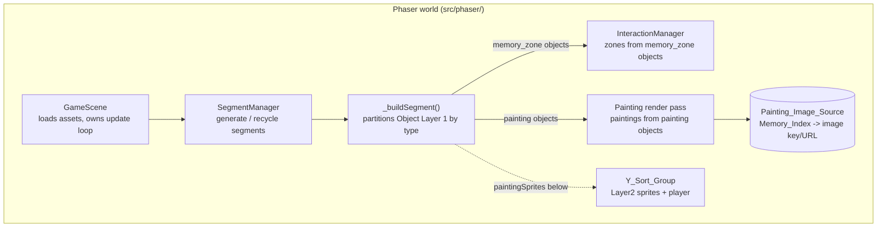
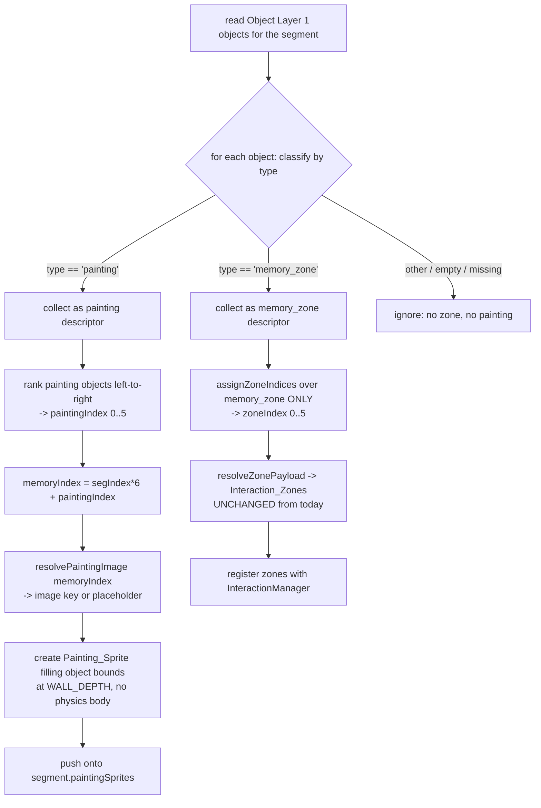

# Design Document: Wall Paintings

## Overview

The Wall Paintings feature hangs a pixel-art image inside every framed canvas on the gallery's back wall, so each memory is represented both by its floor Interaction_Zone (which opens the memory overlay) and by a visible painting in its frame. It builds directly on the Infinite Hallway spec and changes only how the Hallway_Map's `Object Layer 1` objects are **classified** and what the scene **renders** from them — all segment generation, zone indexing, memory resolution, bounded growth, and leftward-return behavior are unchanged.

Two concerns drive the design:

1. **Object taxonomy (the safety change).** Today `GameScene._buildSegment()` reads **every** object in a segment's `Object Layer 1` and turns each into a memory Interaction_Zone. The author plans to add 6 new sized objects (the painting rectangles) to that same layer. If the loop kept treating every object as a zone, the 6 paintings would be mis-counted as zones, corrupting `Zone_Index` (which assumes 6 zones per segment) and the `Memory_Index = segIndex*6 + zoneIndex` arithmetic. This feature changes the object read to **partition by Tiled `type`**: only `memory_zone` objects become Interaction_Zones; only `painting` objects become Painting_Sprites; anything else is ignored. Zone indexing is computed over `memory_zone` objects **only**, so the paintings cannot shift any memory.

2. **On-wall painting rendering.** For each `painting` object, the scene renders a pixel image that **fully covers** the object's authored bounds (offset by the segment world offset), at a fixed `Wall_Depth` below the Y-sort group so the player and decor pass in front. The image is resolved from a new static `Painting_Image_Source` keyed by the same `Memory_Index` the co-located memory zone uses, so a painting and its memory are always the same memory. Images start as placeholders and are swapped for real pixel art later by editing only the source's reference locations.

The game stays a static, self-contained site with no backend. Paintings are **purely visual**: they emit no `EventBus` events, have no physics body, and require no React change.

### Design principles carried from the existing code

- **ES modules throughout**; Phaser managers/scenes are ES classes with JSDoc; static content is a plain ES module (`src/data/*.js`) imported, never fetched.
- **Feet-origin Y-sort is for dynamic actors only.** Paintings are **not** Y-sorted — they are flat wall art at a fixed depth below every `Y_Sort_Group` member, like the floor/back-wall layer.
- **Pixel-perfect.** Prefer 1:1 image placement; when scaling is unavoidable, scale to fill the bounds (see the fill decision) rather than leaving sub-pixel gaps.
- **Graceful asset failure.** A missing or failed painting image falls back to a placeholder and never raises a scene-level error or halts segment building, mirroring the existing per-tile collision `floor` fallback.
- **Heavy media by URL.** Painting image references may be local asset keys or external URLs; heavy media is kept out of the bundle.
- **Deterministic per-segment rebuild.** Like zones, a painting's resolved image is a pure function of its `Memory_Index`, so re-entering a `Segment_Index` renders the identical painting.

---

## Architecture

### Research notes informing the design

- **Tiled object `type`/class in exported JSON.** In Tiled's JSON export, an object's class is written to the `type` field (older Tiled) or `class` field (Tiled ≥ 1.9). The current maps export `type`. To be robust across Tiled versions, the classifier reads `obj.type ?? obj.class ?? ''`. The existing `_findPlayerSpawn` already matches on `obj.type === 'player_spawn' || obj.name === 'player_spawn'`, confirming `type` is the authored field in these maps.
- **Current object objects are points.** The 6 existing `memory_zone` objects are points (`width: 0, height: 0`) at `x ∈ {48,208,368,512,672,832}, y = 176` — the left edge of each 3-tile frame. The interaction zone size is already decoupled from the object size (it uses the fixed `ZONE_WIDTH_PX`/`ZONE_HEIGHT_PX = 48` footprint), so tagging these objects `memory_zone` changes nothing about zone sizing. The **painting** objects, by contrast, will be authored with **real `width`/`height`** matching each frame's inner area, and the renderer uses those bounds directly.
- **Frame geometry.** Each frame is 3 tiles wide (cols shown in `Tile Layer 2` row 5 as `[3,4,5], [13,14,15], …`). The author will size each `painting` object to the frame's inner wall rectangle exactly. The renderer makes no assumption about a specific pixel size; it reads `width`/`height` from the object.
- **Depth bands already exist.** `GameScene` defines `FLOOR_DEPTH = 0` (floor/back-wall, below everything) and `OVERHEAD_DEPTH = 10000` (prompt/overhead, above everything); `Y_Sort_Group` members get `depth = feet world Y` (a positive value for any on-screen actor). A painting on the back wall must sit **above** the floor tiles but **below** every actor. The design introduces `WALL_DEPTH` just above `FLOOR_DEPTH` and strictly below the smallest possible positive feet-Y, so paintings layer correctly between the wall and the actors.
- **Existing segment render/release pattern.** `_buildSegment()` already collects `floorSprites`, `layer2Sprites`, `collisionBodies`, and `zones` on the returned `Segment` handle, and `_releaseSegment()` destroys each on recycle. Paintings follow the identical pattern: a new `paintingSprites` array on the handle, built in `_buildSegment()` and destroyed in `_releaseSegment()`.

### High-level component diagram



### Object partition flow (the core change in `_buildSegment`)



### Layer / depth ordering (extends the existing convention)

| Draw order | Contents | Depth |
|---|---|---|
| Bottom | `Tile Layer 1` floor + back wall | `FLOOR_DEPTH` (`0`) |
| **Wall art (new)** | **Painting_Sprites (flat on the back wall)** | **`WALL_DEPTH` (just above floor, strictly below every actor)** |
| Middle (Y-sorted) | `Tile Layer 2` decor sprites + player | `depth = feet world Y`, re-applied each frame |
| Top | `Prompt_Label` / overhead | `>= OVERHEAD_DEPTH` (`10000`) |

`WALL_DEPTH` is a small positive constant (e.g. `1`) that is `> FLOOR_DEPTH` and strictly `<` the minimum feet world Y of any actor. Since actors stand on the floor band (feet Y well above a single-digit value — the start-map floor top row is dozens of pixels down), `WALL_DEPTH = 1` is safely below every `Y_Sort_Group` member. The design records the invariant (`WALL_DEPTH < min actor feet Y`) rather than coupling to a specific number, and a property test asserts strict `<` against the Y-sort band.

---

## Components and Interfaces

### New components

#### `src/data/paintings.js` — the Painting_Image_Source

A static ES module, parallel to `src/data/memories.js`, mapping each authored `Memory_Index` to a painting-image reference (a Phaser texture key and/or a URL). It performs **no** network access; it is imported at build-segment time.

```js
/**
 * paintings.js — the static Painting_Image_Source for the Wall Paintings feature.
 *
 * Pure, static ES module (no fetch/network). Maps a Memory_Index to the pixel-art
 * image shown inside that memory's frame. Entries are PLACEHOLDERS until the real
 * pixel art is authored; swapping in real art later requires editing ONLY the
 * references here (and adding the asset), with no change to zone/segment logic.
 *
 * @typedef {object} PaintingEntry
 * @property {string} key   Phaser texture key loaded in GameScene.preload()
 * @property {string|null} url  optional external URL (heavy media kept out of the bundle)
 */

/** Texture key used when a Memory_Index has no painting or its image failed to load. */
export const PAINTING_PLACEHOLDER_KEY = 'painting_placeholder';

/**
 * PAINTINGS — Painting_Image_Source. Keyed by Memory_Index (0-based). Holds exactly N
 * authored entries at contiguous indices 0..N-1, matching the Memories_Manifest size.
 * Each entry's `key` is the texture key the scene renders; a null/absent entry or a
 * failed-to-load texture resolves to PAINTING_PLACEHOLDER_KEY.
 * @type {Record<number, PaintingEntry>}
 */
export const PAINTINGS = {
  0: { key: 'painting_placeholder', url: null },
  1: { key: 'painting_placeholder', url: null },
  // … one per authored Memory_Index; all placeholders for now
};
```

> Note: Until real art exists, every entry simply points at `PAINTING_PLACEHOLDER_KEY`, so the module can even start as "no authored entries + always placeholder." The shape above is forward-compatible with per-memory keys.

#### `src/phaser/paintingResolve.js` — pure painting resolver

A small pure helper (mirroring `memoryResolve.js`) that maps a segment index + painting rank to a `Memory_Index` and resolves its image key. Pure and unit/property-testable without a live scene.

```js
/**
 * paintingResolve.js — pure painting-ordering and image-resolution helpers.
 * No Phaser/DOM dependency.
 * Requirements: 1.6, 3.1, 3.2, 3.3, 3.5, 5.2
 */
import { PAINTINGS, PAINTING_PLACEHOLDER_KEY } from '../data/paintings.js';

/**
 * assignPaintingIndices — pure: rank painting descriptors by (x asc, y asc, id asc)
 * and tag each with its 0-based paintingIndex. Identical ordering rule to
 * assignZoneIndices, so painting rank k aligns with memory-zone rank k. (Req 3.2)
 * @template {{x:number,y:number,id:number}} T
 * @param {T[]} objects
 * @returns {(T & {paintingIndex:number})[]}
 */
export function assignPaintingIndices(objects) {
  return [...objects]
    .sort((a, b) => a.x - b.x || a.y - b.y || a.id - b.id)
    .map((obj, paintingIndex) => ({ ...obj, paintingIndex }));
}

/**
 * resolvePaintingImage — pure: map a (segIndex, paintingIndex) to its Memory_Index and
 * the texture key to render. Authored Memory_Index (< N) uses its PAINTINGS entry key;
 * a Future_Painting (>= N), a missing entry, or a missing key resolves to the
 * placeholder key. (Req 3.3, 3.5, 5.2)
 * @param {number} segIndex
 * @param {number} paintingIndex  0..5
 * @param {Record<number,{key:string}>} source  the PAINTINGS source
 * @param {number} authoredMemoryCount  N
 * @returns {{memoryIndex:number, key:string, isPlaceholder:boolean}}
 */
export function resolvePaintingImage(segIndex, paintingIndex, source, authoredMemoryCount) {
  const memoryIndex = segIndex * 6 + paintingIndex;
  if (memoryIndex < authoredMemoryCount) {
    const entry = source[memoryIndex];
    const key = entry && entry.key ? entry.key : PAINTING_PLACEHOLDER_KEY;
    return { memoryIndex, key, isPlaceholder: key === PAINTING_PLACEHOLDER_KEY };
  }
  return { memoryIndex, key: PAINTING_PLACEHOLDER_KEY, isPlaceholder: true };
}
```

### Modified components

#### `src/phaser/GameScene.js`

**`preload()`** — add a load for the placeholder painting texture and (later) any authored painting textures referenced by `PAINTINGS`. The placeholder is a tiny bundled pixel asset (e.g. `assets/photos/placeholder.png`, which already exists) loaded under `PAINTING_PLACEHOLDER_KEY`. A `loaderror` on a painting texture is handled **locally** (it does **not** set the scene-level `_loadError`): the scene continues and that painting falls back to the placeholder (Req 5.4). This mirrors how the player-sprite error is handled separately from the global flag today.

```js
// in preload(), alongside the tileset/sprite loads
this.load.image(PAINTING_PLACEHOLDER_KEY, 'assets/photos/placeholder.png');
// future: for each authored PAINTINGS entry with a url/local asset, load its key.
// A painting loaderror flips only a per-key "missing" marker, never _loadError.
```

**`_buildSegment(index, worldOffsetX)`** — change the `Object Layer 1` read from "all objects are zones" to a **type partition**. Today the method does:

```js
const rawObjects = objectLayer?.objects ?? [];
const descriptors = rawObjects.map(o => ({ x, y, id }));
const ordered = assignZoneIndices(descriptors);
// … build a zone for every object
```

It becomes:

```js
const rawObjects = objectLayer?.objects ?? [];
const typeOf = (o) => (o && (o.type ?? o.class ?? '')) || '';

// (c1) memory zones — UNCHANGED indexing, just filtered to type === 'memory_zone'
const zoneObjects = rawObjects.filter((o) => typeOf(o) === 'memory_zone');
const zoneDescriptors = zoneObjects.map((o) => ({ x: o.x, y: o.y, id: o.id }));
const orderedZones = assignZoneIndices(zoneDescriptors);
// … existing resolveZonePayload + _createZone loop over orderedZones (verbatim)

// (c2) paintings — new render pass, type === 'painting'
const paintingObjects = rawObjects.filter((o) => typeOf(o) === 'painting');
const orderedPaintings = assignPaintingIndices(
  paintingObjects.map((o) => ({ x: o.x, y: o.y, id: o.id, width: o.width, height: o.height }))
);
for (const p of orderedPaintings) {
  const { key } = resolvePaintingImage(index, p.paintingIndex, PAINTINGS, authoredMemoryCount);
  const sprite = this._createPaintingSprite(worldOffsetX + p.x, p.y, p.width, p.height, key);
  if (sprite) paintingSprites.push(sprite);
}
```

Objects whose type is neither value are naturally excluded by both filters (Req 1.5). `assignZoneIndices` runs over **memory zones only**, so paintings never perturb `Zone_Index`/`Memory_Index` (Req 1.6, 2.1–2.4). The returned `Segment` handle gains a `paintingSprites` array.

**`_createPaintingSprite(worldX, worldY, width, height, textureKey)` (new private helper)** — create a non-physics image that fully covers the object's bounds at `WALL_DEPTH`.

```js
/**
 * Create a Painting_Sprite filling an object's world-offset bounds at WALL_DEPTH.
 * Top-left origin at (worldX, worldY); setDisplaySize(width, height) stretches the
 * texture to exactly fill the bounds (full coverage, Req 4.2, 4.4). No physics body
 * (Req 4.5). Falls back to the placeholder texture when the requested key is missing
 * or failed to load (Req 5.2). Returns null in headless/mock contexts.
 */
_createPaintingSprite(worldX, worldY, width, height, textureKey) {
  if (typeof this.add?.image !== 'function') return null;
  const key = this.textures?.exists?.(textureKey) ? textureKey : PAINTING_PLACEHOLDER_KEY;
  const sprite = this.add.image(worldX, worldY, key);
  if (sprite?.setOrigin) sprite.setOrigin(0, 0);
  if (sprite?.setDisplaySize && width > 0 && height > 0) sprite.setDisplaySize(width, height);
  if (sprite?.setDepth) sprite.setDepth(this.WALL_DEPTH);
  return sprite;
}
```

**Fill strategy (design decision).** Per Req 4.2/4.4 the painting must **fully cover** the object bounds with no gaps. The chosen implementation is **`setDisplaySize(width, height)`** — a direct stretch to the exact bounds. Rationale:

- When the author sizes the frame object to the image's native pixel dimensions (the intended happy path, Req 4.3), `setDisplaySize(nativeW, nativeH)` is an identity transform → 1:1, pixel-perfect.
- When dimensions differ, stretch guarantees **full coverage with zero cropping and zero gaps**, which satisfies "fill the whole object, scale or cut off excess" while being the simplest, most predictable transform. (Scale-and-crop, the other allowed strategy in Req 4.4, would require a crop rectangle and risks hiding image content; stretch keeps the whole image visible. Either is spec-compliant; stretch is chosen for simplicity and because the author intends near-exact sizing.)
- `pixelArt: true` + `roundPixels: true` are already set globally, so nearest-neighbor sampling keeps even a stretched pixel image crisp (no bilinear blur), consistent with the retro look.

**`_releaseSegment(segment)`** — add disposal of the new `paintingSprites`, mirroring the existing `floorSprites` branch (plain destroy; paintings never joined the sort group and have no physics body):

```js
const paintings = Array.isArray(segment.paintingSprites) ? segment.paintingSprites : [];
for (const sprite of paintings) {
  if (sprite && typeof sprite.destroy === 'function') sprite.destroy();
}
```

**New scene constant** — `this.WALL_DEPTH = 1;` declared in the constructor alongside `FLOOR_DEPTH` / `OVERHEAD_DEPTH`, with a JSDoc note that it must stay `> FLOOR_DEPTH` and `<` the minimum actor feet-Y.

#### Unchanged components

- **`InteractionManager`, `SegmentManager`, `PromptLabel`, `CollisionBuilder`, `PlayerController`, `memoryResolve.js`, `EventBus.js`** — no change. `SegmentManager` already injects `buildSegment`/`releaseSegment` closures; only the closure bodies in `GameScene` change.
- **`App.jsx`, `DialogueBox.jsx`, `ImageViewer.jsx`, `EventBus.js`** — no change. Paintings emit no events and add no overlay behavior (Req 7.1–7.3).
- **`src/data/memories.js`** — unchanged; `paintings.js` is a parallel source keyed by the same `Memory_Index`.

---

## Data Models

### Painting object descriptor (read from `Object Layer 1`)

```js
/**
 * @typedef {object} PaintingObject
 * @property {number} x       tile-local X of the object's top-left (Tiled)
 * @property {number} y       tile-local Y of the object's top-left (Tiled)
 * @property {number} width   object width in px (frame inner area); > 0 for a sized object
 * @property {number} height  object height in px (frame inner area); > 0 for a sized object
 * @property {number} id      Tiled object id (tie-break for ordering)
 */
```

### Painting render descriptor (after ordering + resolution)

```js
/**
 * @typedef {object} PaintingRender
 * @property {number} paintingIndex  0..5 rank by ascending local x (ties: y, then id) (Req 3.2)
 * @property {number} memoryIndex    segIndex*6 + paintingIndex (Req 3.2)
 * @property {string} textureKey     resolved texture key (authored or placeholder) (Req 3.3, 5.2)
 * @property {boolean} isPlaceholder true when the resolved key is the placeholder (Req 3.5, 5.2)
 */
```

### Segment handle extension

```js
/**
 * The Segment handle returned by _buildSegment gains:
 * @property {Phaser.GameObjects.Image[]} paintingSprites  flat wall images at WALL_DEPTH,
 *   no physics body; destroyed in _releaseSegment (Req 4.6, 4.7).
 */
```

### Painting image source

- **Location:** `Front-end/src/data/paintings.js` — a static module exporting `PAINTINGS` (keyed by `Memory_Index`) and `PAINTING_PLACEHOLDER_KEY`. Imported, never fetched (Req 5.5).
- **Shape:** `Record<number, { key: string, url: string|null }>`, holding entries at `0..N-1` (same `N` as the Memories_Manifest).
- **Placeholder:** `PAINTING_PLACEHOLDER_KEY` names a bundled pixel texture loaded in `preload()`; it is the fallback for Future_Paintings, missing entries, and failed loads (Req 3.5, 5.1, 5.2).
- **Authoring follow-up:** swapping in real art = edit the `key`/`url` references here + add the asset + load it in `preload()`. No zone/segment/resolution logic changes (Req 5.3).

### Scene depth constant

- `WALL_DEPTH` — small positive constant (`1`), `> FLOOR_DEPTH (0)` and strictly `<` the minimum feet world Y of any actor, so paintings draw above the back wall and below every `Y_Sort_Group` member (Req 4.4).

---

## Correctness Properties

*A property is a characteristic or behavior that should hold true across all valid executions of a system — a formal statement about what the system should do.*

These 11 properties mirror the Correctness Properties in `requirements.md`. Each is implemented by exactly one fast-check property test (≥100 iterations) against pure logic (`assignPaintingIndices`, `resolvePaintingImage`, the type-partition helper) and the scene's painting-render predicates, using Phaser mocks in the existing `__tests__` style.

### Property 1: Type-partitioned reads

*For all* object layers mixing `memory_zone`, `painting`, and other/untyped objects, the set of objects that produce Interaction_Zones SHALL equal exactly the `memory_zone` objects, and the set that produce Painting_Sprites SHALL equal exactly the `painting` objects.

**Validates: Requirements 1.2, 1.3, 1.4, 1.5**

### Property 2: Zone-index invariance under paintings

*For all* object layers, adding, removing, or repositioning any number of `painting` objects SHALL leave every `memory_zone` object's `Zone_Index` and `Memory_Index` unchanged.

**Validates: Requirements 1.6, 2.1, 2.2**

### Property 3: Zone-count invariance

*For all* object layers containing exactly 6 `memory_zone` objects, the number of Interaction_Zones built per segment SHALL equal 6 regardless of the number of `painting` objects.

**Validates: Requirements 2.3, 2.4**

### Property 4: Painting–memory index agreement

*For all* segment indices `s` and ranks `z` in `0..5`, ranking `painting` objects and `memory_zone` objects by the same `(x, y, id)` rule SHALL yield, at rank `z`, a Painting_Object and a Memory_Zone_Object with the identical `Memory_Index = s*6 + z`.

**Validates: Requirements 3.1, 3.2**

### Property 5: Painting determinism on return

*For all* right-then-left movement paths, the resolved painting texture key for a given `Segment_Index` SHALL be identical across re-instantiations of that `Segment_Index`.

**Validates: Requirements 3.4**

### Property 6: Future painting shows placeholder

*For all* `Memory_Index` values greater than or equal to `N`, `resolvePaintingImage` SHALL resolve to `PAINTING_PLACEHOLDER_KEY` with `isPlaceholder === true`.

**Validates: Requirements 3.5**

### Property 7: Full bounds coverage

*For all* `painting` objects with positive width and height, the created Painting_Sprite SHALL have top-left origin at the object's world-offset position and display size equal to the object's `width`×`height`, so it fully covers the bounds with no visible pixels outside them.

**Validates: Requirements 4.2, 4.4**

### Property 8: Wall depth ordering

*For all* Painting_Sprites and all `Y_Sort_Group` members (whose depth equals a positive feet world Y), the Painting_Sprite's `WALL_DEPTH` SHALL be strictly less than every member's depth and strictly greater than `FLOOR_DEPTH`.

**Validates: Requirements 4.4**

### Property 9: Paintings are non-collidable

*For all* created Painting_Sprites, no physics body SHALL be created or added, so no Player movement path is blocked by a painting.

**Validates: Requirements 4.5**

### Property 10: Graceful image fallback

*For all* `painting` objects whose resolved texture key is absent from the texture cache, the scene SHALL substitute `PAINTING_PLACEHOLDER_KEY` and still create a sprite, with no scene-level `_loadError` set and no halt of segment building.

**Validates: Requirements 5.2, 5.4**

### Property 11: No events from paintings

*For all* Player paths that overlap or pass only `painting` objects (overlapping no `memory_zone` object), no `hotspot-activated` event SHALL be emitted and the Player SHALL not freeze.

**Validates: Requirements 7.1, 7.2**

---

## Error Handling

| Condition | Requirement | Behavior |
|---|---|---|
| Object has `type` neither `memory_zone` nor `painting` (incl. empty/missing) | 1.5 | Excluded by both filters; builds no zone and no painting; segment build continues. |
| Previously-interactive object loses its `type` after re-export | 6.5 | Falls into the "ignored" case → no Interaction_Zone for it (a missing memory), not a crash. |
| Painting texture key missing from the texture cache at build time | 5.2 | `_createPaintingSprite` substitutes `PAINTING_PLACEHOLDER_KEY`; sprite still created. |
| Painting image asset fails to load in `preload()` | 5.4 | Local per-key handling only; `_loadError` is **not** set; the painting renders the placeholder; segment generation is not halted. |
| `painting` object authored with zero width/height | 4.2 | `setDisplaySize` guard (`width > 0 && height > 0`) skips resizing; sprite renders at the texture's native size at the object position (degenerate authoring; no crash). |
| Headless/mock scene (no `this.add.image`) | — | `_createPaintingSprite` returns null; `paintingSprites` simply omits it; build continues (keeps unit tests inert). |
| Future_Painting (`Memory_Index >= N`) | 3.5 | `resolvePaintingImage` returns the placeholder key; the frame shows the placeholder art. |

---

## Testing Strategy

The suite keeps the existing dual approach — **example-based** tests (Vitest + `@testing-library/react` + jsdom) and **property-based** tests (fast-check, ≥100 iterations) — and mirrors current conventions: tests in `__tests__/` beside the code, named `*.test.{js,jsx}`, property variants `*.property.test.*`, Phaser mocked at module level.

### Property-based tests (fast-check)

Each property above maps to one property test file, headed `// Feature: wall-paintings, Property {N}: {text}` plus `**Validates: Requirements X.Y**`.

| Property | Target | New test file |
|---|---|---|
| 1 Type-partitioned reads | type-partition helper in `_buildSegment` (extract a pure `partitionObjectsByType`) | `ObjectPartition.property.test.js` |
| 2 Zone-index invariance under paintings | `assignZoneIndices` over filtered zones | `PaintingZoneInvariance.property.test.js` |
| 3 Zone-count invariance | partition + `assignZoneIndices` | `PaintingZoneInvariance.property.test.js` (second block) |
| 4 Painting–memory index agreement | `assignPaintingIndices` vs `assignZoneIndices` | `PaintingIndex.property.test.js` |
| 5 Painting determinism on return | `resolvePaintingImage` | `PaintingResolve.property.test.js` |
| 6 Future painting placeholder | `resolvePaintingImage` | `PaintingResolve.property.test.js` (second block) |
| 7 Full bounds coverage | `GameScene._createPaintingSprite` (mock `add.image`) | `GameScene.paintings.property.test.js` |
| 8 Wall depth ordering | `WALL_DEPTH` vs feet-Y band | `GameScene.paintings.property.test.js` (second block) |
| 9 Non-collidable | `_createPaintingSprite` (asserts no `physics.add`) | `GameScene.paintings.property.test.js` (third block) |
| 10 Graceful image fallback | `_createPaintingSprite` with absent key | `GameScene.paintings.property.test.js` (fourth block) |
| 11 No events from paintings | `_buildSegment` + `InteractionManager` (painting-only overlap) | `Paintings.noEvents.property.test.js` |

Representative arbitraries:
- **Mixed object layers:** `fc.array(fc.record({ type: fc.constantFrom('memory_zone','painting','',' prop','decor'), x: fc.integer(), y: fc.integer(), id: fc.integer(), width: fc.nat(), height: fc.nat() }))` → assert the partition selects exactly the right subsets.
- **Zone invariance:** a fixed set of 6 `memory_zone` objects + a random count/placement of `painting` objects; assert the 6 zones' `zoneIndex`/`memoryIndex` are identical with and without the paintings.
- **Index agreement:** `segIndex = fc.nat()`, 6 distinct `{x,y,id}` records; assert `assignPaintingIndices` and `assignZoneIndices` give matching `memoryIndex` per rank.
- **Resolution:** `segIndex = fc.nat()`, `paintingIndex = fc.integer({min:0,max:5})`, `N = fc.nat()`, a `PAINTINGS`-shaped dictionary; assert index formula, authored-vs-placeholder split, determinism on repeat.
- **Sprite geometry:** random `{x,y,width,height}` with a mock `add.image` recording `setOrigin`/`setDisplaySize`/`setDepth`; assert origin `(0,0)`, display size `= (width,height)`, depth `= WALL_DEPTH`.

### Example-based tests (Vitest)

- **`GameScene._buildSegment` partition** (extend `GameScene.segmentFloor.test.js` or new `GameScene.paintings.test.js`): a hallway object layer with 6 `memory_zone` points + 6 sized `painting` rects yields exactly 6 zones (registered with the `InteractionManager`) and exactly 6 `paintingSprites` on the segment handle; an object with an unrecognized type yields neither; a `painting` object produces an image at `worldOffsetX + x`, origin `(0,0)`, display size `(width,height)`, depth `WALL_DEPTH`, and no physics body.
- **Backward compatibility** (extend existing memory-resolution example tests): with the 6 objects tagged `memory_zone`, the emitted `hotspot-activated` payloads for seg0 zone0..5 and seg1 zone0 match the pre-feature `memory-{n}` resolution exactly (Req 2.3).
- **Placeholder fallback** (`GameScene.paintings.test.js`): a `painting` whose resolved key is not in the texture cache renders with `PAINTING_PLACEHOLDER_KEY` and sets no `_loadError` (Req 5.2, 5.4).
- **Release** (extend `GameScene.segmentFloor.test.js`): `_releaseSegment` destroys every `paintingSprite` (Req 4.6, 4.7).
- **Paintings source module** (`paintings.test.js`): `PAINTINGS` and `PAINTING_PLACEHOLDER_KEY` import without network; entries are `{key,...}`-shaped; every `Memory_Index` resolves to a texture key (authored or placeholder) (Req 5.1, 5.5).
- **No React/overlay change** (sanity): no new `hotspot-activated` emission path is added for paintings; the existing `App.integration` behavior is unaffected (Req 7.3).

### Property test configuration

- fast-check `{ numRuns: 100 }` minimum per property.
- One property ⇒ one property-based test; concrete scenarios ⇒ example tests.
- Run `npm run test` (single pass) and `npm run lint` from `Front-end/` before declaring done.

---

## Requirements Mapping

| Requirement | Design element |
|---|---|
| 1.1–1.5 Classify objects by type | `_buildSegment` type partition (`typeOf`, `filter`); `partitionObjectsByType` helper; `ObjectPartition.property.test.js` |
| 1.6 Index over memory zones only | `assignZoneIndices` runs on the `memory_zone` subset; Property 2 |
| 2.1, 2.2 Backward-compatible indexing | unchanged `assignZoneIndices` + `resolveZonePayload`; Property 2 |
| 2.3, 2.4 Zone count stays 6 | filter yields the same 6 zone objects; Property 3 |
| 3.1, 3.2 Painting ↔ memory index | `assignPaintingIndices` + `memoryIndex = segIndex*6 + paintingIndex`; Property 4 |
| 3.3 Image selected by Memory_Index | `resolvePaintingImage` against `PAINTINGS` |
| 3.4 Determinism on return | pure `resolvePaintingImage` + deterministic per-index build; Property 5 |
| 3.5 Future painting placeholder | `resolvePaintingImage` placeholder branch; Property 6 |
| 4.1, 4.2 One sprite per painting, within bounds | `_createPaintingSprite` top-left origin + `setDisplaySize` |
| 4.3 1:1 when sizes match | `setDisplaySize(native, native)` is identity under `pixelArt` |
| 4.4 Fill the bounds (stretch/crop) | `setDisplaySize` stretch-to-fill decision; Property 7, 8 |
| 4.5 Non-collidable, no physics body | `_createPaintingSprite` uses `add.image` (not `physics.add`); Property 9 |
| 4.6, 4.7 Release on recycle | `_releaseSegment` `paintingSprites` disposal |
| 5.1 Placeholder for every index | `PAINTING_PLACEHOLDER_KEY` + `preload` load |
| 5.2, 5.4 Graceful fallback / failed load | `_createPaintingSprite` cache check; local painting `loaderror` handling; Property 10 |
| 5.3 Swap-in requires only reference edits | `src/data/paintings.js` is the sole edit point |
| 5.5 Static, no backend | `paintings.js` imported, not fetched |
| 6.1–6.4 Map authoring compatibility | `typeOf` reads Tiled `type`/`class`; filters build 6 zones + 6 paintings |
| 6.5 Missing type → ignored | "other/untyped" exclusion; Error Handling table |
| 7.1–7.3 No boundary/overlay change | paintings emit no events, add no React component; Property 11 |

---

## Open Questions / Follow-ups

- **Per-memory painting keys vs. one placeholder.** For now `PAINTINGS` points every index at the placeholder. When real art arrives, decide whether each `Memory_Index` gets a distinct bundled texture key (loaded in `preload()`) or an external URL (loaded dynamically). The resolver and render pass already support either; only `paintings.js` + `preload()` change.
- **Scale-and-crop option.** The design chose stretch-to-fill. If the author later prefers aspect-preserving scale-and-crop for off-size images, `_createPaintingSprite` can switch to a cover-fit computation + `setCrop`, with no change elsewhere. Both are allowed by Req 4.4.
